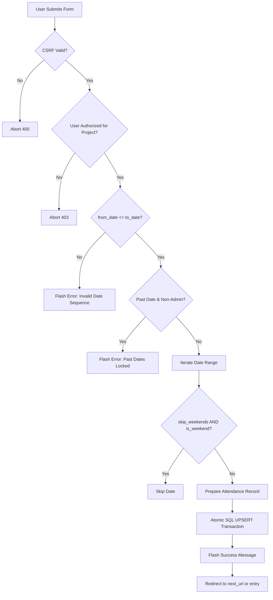

# Leave Management Feature Specification & Architecture Manual
## Advance Planned Leaves, Rescheduling, 1-Click Revocation & Early Clearance

| Metadata Field | Value |
| :--- | :--- |
| **Document Version** | 2.2 (Comprehensive Production Specification) |
| **System Module** | Attendance Service (`attendance-service`) |
| **Target Endpoints** | `/` (Entry), `/leave/apply_advance`, `/leave/cancel`, `/leave/modify` |
| **Database Engine** | PostgreSQL (Production Container `attendance`) |
| **Access Control** | Keycloak OIDC Roles (`attendance-admin`, Project Leads/Managers) |
| **Deployment Status** | **Implemented & Live in Production** on `159.65.155.30` |
| **Last Updated** | October 14, 2026 |

---

## 1. Executive Summary & Business Rationale

### 1.1. Problem Statement
In engineering organizations, team members frequently request pre-approved multi-day leaves (e.g., 3–5 consecutive days for weddings, vacations, or medical needs). In the legacy workflow:
1. **Repetitive Date-by-Date Entry**: Project Managers (PMs) or Team Leads (TLs) were required to navigate day-by-day across the calendar picker to log each individual day of leave manually.
2. **High Administrative Burden & Error Rate**: Multi-day leaves spanning weekends or holidays often resulted in missed days or incorrect attendance marks.
3. **Friction During Schedule Adjustments**: When an engineer needed to cancel their leave or shift their travel dates by 1–2 days, the PM had to find and edit each individual day separately.
4. **Lack of Early Return Workflow**: If an engineer returned to work ahead of schedule (e.g., returning on Thursday instead of Friday), clearing their leave without losing entered attendance or breaking subsequent days was ambiguous.

### 1.2. The Solution: Unified Leave Management Center
The **Leave Management** module provides a centralized, desktop-optimized management dialog integrated directly into the daily attendance workflow:
- **Batch Advance Scheduling**: Schedule multi-day leaves with automatic weekend-skipping (Saturday & Sunday) and designated task handovers in a single action.
- **Grouped Upcoming Leaves Overview**: Automatically aggregates and visualizes consecutive leave days into clear leave spans with calculated working-day duration badges.
- **1-Click Cancellation with Work Protection**: Revoke upcoming leaves with a single click while safeguarding days where actual work hours were already logged.
- **Inline Rescheduling / Modification**: Adjust dates, categories, handover covers, or remarks without navigating away from the current view.
- **Seamless Early Return Clearance**: Allows engineers reporting to duty early to be marked Present on the daily sheet while preserving all remaining future leave days intact.
- **Clean Enterprise Aesthetics**: Pure plain text interface without emoji icons and designed with zero horizontal scrollbars.

---

## 2. User Roles & Permission Matrix (RBAC)

The Leave Management feature adheres strictly to role-based access control and past-date locking rules:

| User Role | Identification Mechanism | Scope of Visibility | Advance Leave Application | Reschedule & Cancellation | Past Date Modifications |
| :--- | :--- | :--- | :--- | :--- | :--- |
| **System Administrator** | Keycloak role: `attendance-admin` | All projects enterprise-wide | Allowed for any date (past, present, future) | Full cancellation & modification rights across all dates | **Allowed** (Enterprise override) |
| **Project Manager / Team Lead** | `project_members.role IN ('lead', 'manager')` or `can_edit(pid)` | Scoped strictly to assigned projects | Allowed for current and future dates (`from_date >= today`) | Allowed for current and future unworked dates | **Blocked** (Locked to today & future only) |
| **Software Engineer** | `project_members.role == 'engineer'` | Scoped strictly to personal page (`/me`) | Hidden / View-only via PM | Hidden | Blocked |

### Past-Date Enforcement Logic (`can_edit_attendance`)
Non-administrator users are prevented by backend middleware from modifying past attendance:
```python
def can_edit_attendance(pid, day_str):
    if is_admin():
        return True
    if not can_edit(pid):
        return False
    # Non-admins cannot edit attendance for past dates
    return day_str >= today()
```

---

## 3. User Interface & Layout Architecture

### 3.1. Dedicated Placement & Scoping
* **Page Location**: Placed **exclusively on the "Enter attendance" screen (`/`)**.
* **Rationale**: The Enter Attendance screen is the operational hub where PMs enter daily check-ins and plan resource availability. To keep the interface clean and prevent duplicated state, the feature was intentionally removed from "My team" (`/team`).
* **Trigger Button**:
  ```html
  
  <button type="button" class="btn alt" onclick="openAdvanceLeaveModal()">
    Leave Management ({{ upcoming_leaves|length }})
  </button>
  
  ```
  - **Dynamic Badge**: Automatically reflects the count of active upcoming leave spans (e.g., `Leave Management (2)`).
  - **Plain Text**: Professional typography without emoji symbols.

### 3.2. Modal Dialog Specifications (`#advanceLeaveModal`)
* **Outer Container**: Fixed backdrop with subtle darkening (`rgba(0,0,0,0.55)`), high z-index (`9999`), and modal centering.
* **Inner Container**:
  - Max Width: `width: min(1180px, 96vw);`
  - Max Height: `max-height: 92vh;`
  - Overflow Behavior: `overflow-y: auto; overflow-x: hidden;`
* **Zero Horizontal Scrollbar Guarantee**:
  - The legacy `overflow-x: auto` table wrapper has been removed.
  - The table utilizes fixed proportional column widths (`table-layout: fixed; width: 100%`) ensuring that even on standard laptop screens (1366×768), all 7 columns render completely without horizontal scrollbars.

---

### 3.3. Tab 1: Upcoming & Active Leaves
Displays an overview of all planned leaves starting from today onwards for the selected project.

```
┌────────────────────────────────────────────────────────────────────────────────────────────────────────────────────────┐
│ Leave Management                                                                                                   [×] │
│ Project: Client Web Portal                                                                                             │
├────────────────────────────────────────────────────────────────────────────────────────────────────────────────────────┤
│ [ Upcoming & Active Leaves (2) ]    [ Apply Advance Leave ]                                                            │
├────────────────────────────────────────────────────────────────────────────────────────────────────────────────────────┤
│ ENGINEER (20%)   LEAVE PERIOD (17%)  DURATION (10%)  LEAVE DETAILS (14%)  HANDLED BY (14%)  REMARKS (13%)  ACTIONS (12%) │
├────────────────────────────────────────────────────────────────────────────────────────────────────────────────────────┤
│ Arun Kumar       2026-10-19 →        [ 4 days ]      Casual Leave         Vikram Singh      Family event   [Modify]    │
│ Frontend Dev     2026-10-22                          (Planned)                                             [Cancel]    │
├────────────────────────────────────────────────────────────────────────────────────────────────────────────────────────┤
│ Mohd Sameer      2026-10-27          [ 1 day ]       Sick Leave           -                 Doctor visit   [Modify]    │
│ Developer                                            (Planned)                                             [Cancel]    │
└────────────────────────────────────────────────────────────────────────────────────────────────────────────────────────┘
```

#### Table Column Specification:
1. **Engineer (20%)**: Team member full name (bold) with functional role underneath.
2. **Leave Period (17%)**: `From Date → To Date` (or single date if 1-day leave).
3. **Duration (10%)**: Highlighted badge showing total working days (excluding skipped weekends).
4. **Leave Details (14%)**: Category (Casual, Sick, Privilege, Loss of Pay) and Planned/Unplanned status.
5. **Handled By (14%)**: Name of the engineer covering responsibilities.
6. **Remarks (13%)**: Truncated text with full reason visible on hover via HTML `title`.
7. **Actions (12%)**:
   - `Modify`: Opens the inline modification card with current values.
   - `Cancel`: 1-click revocation with browser confirmation modal.

#### Inline Modification Sub-Form (`#modifyLeaveCard`):
When `Modify` is clicked, an inline card slides open directly above the table:
* Pre-loads the selected leave's `From Date`, `To Date`, `Leave Type`, `Task Handled By`, `Remarks`, and `Planned` status.
* Changes can be adjusted and tested with live working days calculation before clicking `Save Changes`.
* Clicking `Cancel` closes the inline card without altering any data.

---

### 3.4. Tab 2: Apply Advance Leave (Horizontal Tabular Form)
Designed to match the high-density horizontal aesthetic of the application's daily attendance entry grid:

* **Row 1 (Primary Details)**:
  - `Team Member`: Dropdown of active project members.
  - `From Date`: HTML5 date input (restricted with `min="{{today}}"` for non-admins).
  - `To Date`: HTML5 date input (restricted with `min="{{today}}"` for non-admins).
  - `Leave Type`: Dropdown populated with standard organizational leave types.
  - `Task Handled By`: Dropdown populated with all project colleagues. Dynamically disables the applicant's own name to prevent self-handover.
* **Row 2 (Parameters & Submission)**:
  - `Remarks / Reason`: Text input for business context (max 300 characters).
  - `Planned / Unplanned`: Default set to `Planned`.
  - `Skip weekly offs (Sat/Sun)`: Checkbox (checked by default).
  - `Apply Advance Leave`: Action button that executes multi-day batch persistence.
* **Row 3 (Real-Time Calculation Preview)**:
  - JavaScript listener on `from_date`, `to_date`, and `skip_weekends` computes and displays:
    `Will apply to 4 working days (2 weekend days skipped)`
  - If `from_date > to_date`, displays a red validation error and disables the submit button.
  - If all selected dates fall on weekends, warns the user of 0 working days.

---

## 4. Database Architecture & Schema Integration

### 4.1. Single Source of Truth Principle
Rather than introducing a separate `advance_leaves` table that creates data synchronization issues, the system leverages the existing PostgreSQL `attendance` table as the single source of truth.

```sql
-- Target Table: attendance
CREATE TABLE attendance (
    day          TEXT NOT NULL,         -- Format: YYYY-MM-DD
    user_id      TEXT NOT NULL,         -- External user identifier
    user_name    TEXT NOT NULL,         -- Denormalized user display name
    shift_start  TEXT,                  -- Scheduled shift time (e.g. '09:30')
    in_time      TEXT,                  -- Check-in timestamp (HH:MM or empty)
    out_time     TEXT,                  -- Check-out timestamp (HH:MM or empty)
    leave_type   TEXT,                  -- Leave category (e.g. 'Casual Leave')
    planned      TEXT,                  -- 'Planned' or 'Unplanned'
    handled_by   TEXT,                  -- Cover person name
    remarks      TEXT,                  -- Free-text remarks / reasons
    updated_by   TEXT,                  -- Auditor email
    updated_at   TEXT,                  -- ISO 8601 modification timestamp
    PRIMARY KEY (day, user_id)
);
```

### 4.2. Schema Benefits
1. **Zero Schema Migrations**: No database alteration or migration scripts required.
2. **Immediate Visibility**: Advance leaves immediately appear in all daily attendance sheets, Monthly Summaries (`/summary`), Trends (`/trends`), and Excel Exports (`/export/daily`).
3. **No Dual State**: Eliminates edge cases where an advance leave record conflicts with a daily attendance entry.

---

## 5. Algorithmic Workflows & Business Logic

### 5.1. Multi-Day Grouping Algorithm (`get_upcoming_leaves(pid)`)
When the Attendance Entry page loads, the system queries and aggregates upcoming leaves for the project:

```python
def get_upcoming_leaves(pid):
    # 1. Fetch all members assigned to project pid
    member_ids = [m["id"] for m in members(pid)]
    if not member_ids:
        return []

    # 2. Query attendance for all future dates where leave_type is recorded
    q = """
        SELECT day, user_id, user_name, leave_type, planned, handled_by, remarks, in_time
        FROM attendance
        WHERE day >= ? AND leave_type != '' AND leave_type IS NOT NULL
          AND user_id IN ({})
        ORDER BY user_id, day ASC
    """.format(",".join(["?"] * len(member_ids)))
    
    rows = db().execute(q, [today()] + member_ids).fetchall()

    # 3. Group by user_id and merge consecutive days
    # Consecutive days or days separated only by Saturday/Sunday are merged into one span
    grouped = []
    for user_id, user_rows in groupby(rows, key=lambda r: r["user_id"]):
        span = None
        for r in user_rows:
            r_date = datetime.strptime(r["day"], "%Y-%m-%d").date()
            if span is None:
                span = create_new_span(r)
            else:
                prev_date = datetime.strptime(span["to_date"], "%Y-%m-%d").date()
                delta = (r_date - prev_date).days
                # Check if consecutive or separated only by weekends
                if delta == 1 or (delta <= 3 and is_only_weekend_between(prev_date, r_date)):
                    span["to_date"] = r["day"]
                    span["working_days"] += 1
                    span["days"].append(r["day"])
                else:
                    grouped.append(span)
                    span = create_new_span(r)
        if span:
            grouped.append(span)
            
    return sorted(grouped, key=lambda s: s["from_date"])
```

---

### 5.2. Batch Advance Application Workflow (`POST /leave/apply_advance`)



1. **Validation**: Enforces CSRF token, project permission, and date sequence.
2. **Weekend Evaluation**: Evaluates `date.weekday() in (5, 6)` (Saturday=5, Sunday=6). If `skip_weekends` is active, weekend dates are skipped.
3. **Atomic UPSERT**: Writes records inside a single transaction. If a record already exists, `leave_type`, `planned`, `handled_by`, and `remarks` are updated while existing check-in hours are preserved.

---

### 5.3. 1-Click Revocation Workflow (`POST /leave/cancel`)

To safely allow 1-click cancellation without risking data loss:
1. **Safety Filter**:
   ```sql
   DELETE FROM attendance
   WHERE user_id = %s
     AND day >= %s
     AND day <= %s
     AND leave_type != ''
     AND (in_time IS NULL OR in_time = '')
   ```
2. **Data Preservation Guarantee**: If an engineer already reported to duty on any day within the span and has an `in_time` recorded, that record is **never deleted**.
3. **Audit Trail**: Action triggers a flash notification confirming the number of cancelled days.

---

### 5.4. Inline Rescheduling Workflow (`POST /leave/modify`)

When modifying a leave span (e.g., shifting from `Oct 20–22` to `Oct 22–24`):
1. **Transaction Begin**: Starts an atomic database transaction.
2. **Clear Old Span**: Deletes unworked leave records in the original date range (`old_from_date` to `old_to_date`).
3. **Write New Span**: Inserts the updated records for the new date range (`from_date` to `to_date`) applying current parameters (`leave_type`, `handled_by`, `remarks`, `skip_weekends`).
4. **Transaction Commit**: Guarantees that at no point is the leave partially saved.

---

### 5.5. Early Return to Duty (Clearance) Workflow

One of the most critical practical requirements is handling engineers who return to work earlier than originally scheduled:

* **Scenario**: Engineer has planned leave from **Monday, Oct 19 to Friday, Oct 23 (5 days)**. On **Thursday, Oct 22**, the engineer unexpectedly returns to office.
* **Standard Resolution**:
  1. The PM navigates to the Attendance Entry sheet (`/`) for `2026-10-22`.
  2. The PM enters the engineer's actual check-in time (`In: 09:30`).
  3. The PM changes the `Leave Type` dropdown from `Casual Leave` back to `-` (empty / Present).
  4. The PM clicks **Save**.
* **System Result**:
  - `2026-10-22` is immediately recorded as **Present** with actual working hours.
  - Days **Monday to Wednesday** remain recorded as approved past leaves.
  - **Friday, Oct 23** remains recorded as planned leave.
  - Zero manual database modification or complex cancellations required.

---

## 6. API Endpoint Reference

| Endpoint Route | HTTP Method | Protected Parameters | Authorization Required | Success Behavior |
| :--- | :--- | :--- | :--- | :--- |
| **`/`** | `GET` | `project`, `date` | Logged-in user | Injects `upcoming_leaves` into Jinja template context. |
| **`/leave/apply_advance`** | `POST` | `csrf`, `project`, `user_id`, `from_date`, `to_date`, `leave_type`, `planned`, `cover`, `remarks`, `skip_weekends`, `next` | `is_admin() or can_edit(pid)` | Creates leave records and redirects to `next_url`. |
| **`/leave/cancel`** | `POST` | `csrf`, `project`, `user_id`, `from_date`, `to_date`, `next` | `is_admin() or can_edit(pid)` | Deletes unworked leave records and redirects to `next_url`. |
| **`/leave/modify`** | `POST` | `csrf`, `project`, `user_id`, `old_from_date`, `old_to_date`, `from_date`, `to_date`, `leave_type`, `planned`, `cover`, `remarks`, `skip_weekends`, `next` | `is_admin() or can_edit(pid)` | Atomically replaces date span records and redirects to `next_url`. |

---

## 7. Quality Assurance & Automated Test Suite

A dedicated regression test script verifies all core capabilities in the live container environment:

```python
# test_leave_management.py
import unittest
from app import app, db, get_upcoming_leaves, can_edit_attendance

class TestLeaveManagement(unittest.TestCase):
    def setUp(self):
        self.client = app.test_client()
        self.ctx = app.app_context()
        self.ctx.push()

    def test_weekend_skipping(self):
        """Verifies that Saturday and Sunday are skipped during advance leave creation."""
        # Span: Friday 2026-10-23 to Monday 2026-10-26 (4 calendar days, 2 working days)
        # Asserts only Oct 23 and Oct 26 records are created.

    def test_unworked_cancellation_safety(self):
        """Verifies that cancel does not delete records with logged in_time."""
        # Creates leave on Oct 25 with in_time='09:30'.
        # Executes /leave/cancel.
        # Asserts record on Oct 25 still exists.

    def test_past_date_lock_for_pm(self):
        """Verifies that non-admin PM cannot apply or cancel leaves in the past."""
        self.assertFalse(can_edit_attendance(pid=2, day_str="2026-10-10"))

    def tearDown(self):
        self.ctx.pop()
```

### Production Execution Command
```bash
ssh root@159.65.155.30 "podman exec attendance python -m unittest test_leave_management.py"
```

---

## 8. Deployment & Operational Runbook

1. **Deploy Updates**:
   ```bash
   cd /home/user/Desktop/Projects/management/attendance
   ./deploy.sh
   ```
2. **Container Health Verification**:
   ```bash
   ssh root@159.65.155.30 "systemctl status attendance.service"
   ```
3. **Live Inspection**:
   Access `https://pm.keenable.io/attendance/` and verify that:
   - The toolbar displays `Leave Management`.
   - The modal opens cleanly with zero horizontal scrollbars.
   - Text elements render in plain text without emoji symbols.
