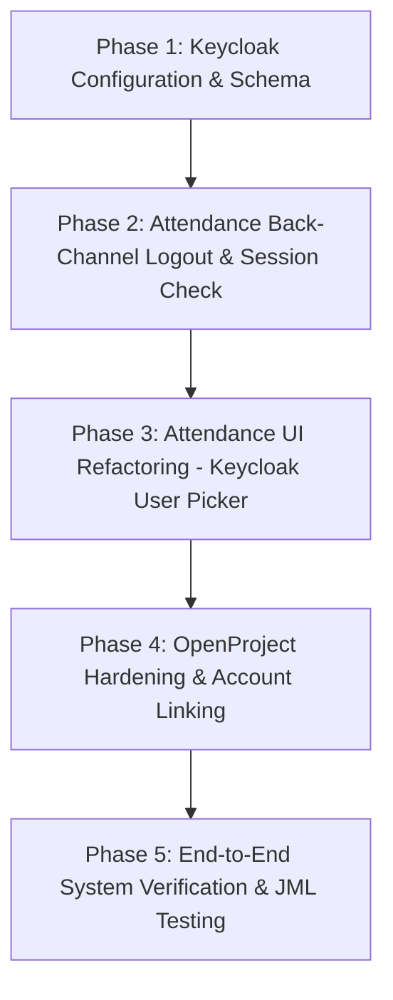

# Phased Implementation Plan: Keycloak Unified Identity & Back-Channel Single Sign-Out (SLO)

**Document Version**: 1.0.0  
**Date**: October 19, 2026  
**Status**: Pending User & Senior Approval  
**Architecture Reference**: *"User Identity: One Source of Truth"* by @Arun

---

## Executive Overview

To transition our ecosystem (Keycloak, OpenProject, Attendance) into a true **Single Source of Truth (SSOT)** model and implement **Single Sign-Out (SLO) via OIDC Back-Channel Logout (Option C)**, the implementation is structured into 5 distinct, sequential phases.

Each phase contains specific tasks, clear deliverables, and immediate verification steps to ensure no disruption to ongoing operations.



---

## User Review Required

> [!IMPORTANT]
> **Key Decisions to Review Before Execution**:
> 1. **Phase 2 & 3 Deployment Order**: Attendance Back-Channel Logout (Phase 2) will be deployed first so session invalidation works, followed by the Team page UI refactor (Phase 3).
> 2. **Keycloak API Service Account**: Phase 3 requires Attendance backend to query Keycloak's User Directory API (`GET /admin/realms/keenable/users`). A client service account with `view-users` role will be used for secure service-to-service communication.
> 3. **Manual Entry Deprecation**: Once Phase 3 is deployed, TL/PMs will no longer be able to type new engineer names or phone numbers manually on `/attendance/team`. All engineers must exist in Keycloak beforehand.

---

## Proposed Implementation Phases & Tasks

---

### Phase 1: Keycloak Directory Schema & Session Configuration

**Objective**: Configure Keycloak realm attributes and client settings required for contact numbers, back-channel logout webhooks, and session timeouts.

* [ ] **Task 1.1: Configure `contact_number` User Attribute Schema**
  * In Keycloak Realm (`keenable`) -> *User Profile*, add attribute `contact_number` (display name: "Contact Number", string, optional/required for staff).
* [ ] **Task 1.2: Populate Contact Numbers for Existing Staff**
  * Update existing user profiles in Keycloak (e.g. Arun Kumar Pal: `9650239996`, Mohd Sadik: `8279726323`) to ensure data continuity when switching away from manual entry.
* [ ] **Task 1.3: Configure `attendance` Client for Back-Channel Logout**
  * Backchannel Logout URL: `https://pm.keenable.io/attendance/auth/backchannel-logout`
  * Backchannel Logout Session Required: `ON`
  * Frontchannel Logout: `OFF`
  * Valid Post-Logout Redirect URIs: `https://pm.keenable.io/*`
* [ ] **Task 1.4: Configure Realm Session Lifetimes**
  * Set `SSO Session Idle`: `8 Hours` (28800s)
  * Set `SSO Session Max`: `10 Hours` (36000s) matching normal working hours.

**Phase 1 Verification**:
* Verify attribute `contact_number` appears in Keycloak user edit form.
* Verify Keycloak client settings saved successfully via Keycloak Admin Console / API.

---

### Phase 2: Attendance App — OIDC Back-Channel Logout & Session Invalidation (Option C)

**Objective**: Enable Attendance to receive and process server-to-server logout tokens from Keycloak, instantly dropping user sessions when sign-out is triggered from anywhere.

* [ ] **Task 2.1: Implement `/attendance/auth/backchannel-logout` in Flask (`app.py`)**
  * Add endpoint:
    ```python
    @app.route("/auth/backchannel-logout", methods=["POST"])
    @app.route("/attendance/auth/backchannel-logout", methods=["POST"])
    def backchannel_logout():
        ...
    ```
  * Verify `logout_token` JWT parameter sent by Keycloak:
    * Validate token signature using Keycloak Realm JWKS (`https://pm.keenable.io/auth/realms/keenable/protocol/openid-connect/certs`).
    * Validate `iss` (realm URL), `aud` (client ID `attendance`), and presence of event `http://schemas.openid.net/event/backchannel-logout`.
  * Extract `sub` (Keycloak User ID) and `sid` (Session ID).
* [ ] **Task 2.2: Session Revocation / Token Invalidation Store**
  * Store revoked `sub` / `sid` timestamps in a shared cache / lightweight database table (`revoked_sessions`).
  * In Attendance request middleware (`before_request`), check if user's session `sub` or `sid` was revoked after session creation time. If revoked, immediately call `session.clear()` and abort/redirect to Keycloak.
* [ ] **Task 2.3: 5-Minute Safety Net Token Check**
  * If no back-channel event occurred, verify session age against Keycloak every 5 minutes in `before_request`.
* [ ] **Task 2.4: Empty `ADMIN_EMAILS`**
  * Update `/etc/attendance/attendance.env` on server to set `ADMIN_EMAILS=""` so Keycloak realm roles (`admin`, `manager`, `lead`, `engineer`) exclusively control access without local hardcoded overrides.

**Phase 2 Verification**:
* Send a simulated Keycloak back-channel logout POST request; verify Attendance logs show session revocation and active cookie is rejected on next click.
* Verify `ADMIN_EMAILS=""` correctly lets Keycloak realm `admin` users retain admin rights.

---

### Phase 3: Attendance App — Remove Manual User Entry & Implement Keycloak User Picker

**Objective**: Eliminate manual typing of engineer names/emails/phones on `https://pm.keenable.io/attendance/team` and allow TL/PMs to select engineers directly from Keycloak directory.

* [ ] **Task 3.1: Keycloak User Directory Search Service in Backend**
  * In `attendance-service/app.py`, implement helper `keycloak_get_engineers(query=None)`:
    * Connects to Keycloak Admin API using service credentials (`client_credentials` grant with `view-users` permission).
    * Queries Keycloak users in realm `keenable` having role `engineer` (or all staff).
    * Returns list of `{sub, username, name, email, contact_number, role}`.
* [ ] **Task 3.2: Refactor `/attendance/team` (My Team Page) UI**
  * Remove the **"Add engineers"** manual text fields (`Engineer name`, `Role`, `Mobile number`, `Email`).
  * Add a searchable **Keycloak Engineer Selection Dropdown**:
    * Input field with live autocomplete searching Keycloak users by name or email.
    * Displays user's name, email, and contact number dynamically fetched from Keycloak.
    * Shift Start time dropdown (`09:30 AM` etc.).
    * Submit button: `[ + Assign Engineer to Team ]`.
* [ ] **Task 3.3: Backend Assignment Handler Refactor (`/team/add`)**
  * Update `/team/add` handler in `app.py`:
    * Accepts `keycloak_sub` (User UUID) and `shift`.
    * Validates user exists in Keycloak.
    * Assigns user to project team, storing their Keycloak `sub` ID as the reference identifier.
    * Stops creating rows in legacy `app_users` table with typed names/emails.
* [ ] **Task 3.4: Dynamic Team Rendering**
  * On `/attendance/team`, team member details (Name, Email, Contact Number) are rendered directly from Keycloak directory rather than stale local database columns.
  * Update "Source" column to display `"Keycloak User"` instead of `"Added by hand"`.

**Phase 3 Verification**:
* Open `/attendance/team` as TL/PM. Verify manual text boxes are gone.
* Search for an engineer in the Keycloak dropdown; verify their details auto-populate.
* Assign them to a project team; verify successful assignment with zero manual typing.

---

### Phase 4: OpenProject Hardening & Back-Channel Logout Registration

**Objective**: Disable local password authentication in OpenProject, enforce direct Keycloak login, and link existing user accounts.

* [ ] **Task 4.1: Enforce Container Environment Flags**
  * In OpenProject environment (`/etc/openproject/conf.d/` or docker/podman compose env):
    * `OPENPROJECT_DISABLE__PASSWORD__LOGIN=true`
    * `OPENPROJECT_OMNIAUTH__DIRECT__LOGIN__PROVIDER=keycloak`
* [ ] **Task 4.2: Register OpenProject Back-Channel Logout in Keycloak**
  * Verify OpenProject's OIDC logout receiver URL in client `openproject`:
    * Set Backchannel Logout URL (or configure via `keycloak_sso.rb` extension).
    * Backchannel Logout Session Required = `ON`.
* [ ] **Task 4.3: User Account Linking & Cleanup**
  * Verify existing accounts (`oppm@fosteringlinux.com`, etc.) are linked to Keycloak `sub` upon first login.
  * Delete/disable test-only local users (e.g. `test@keenable.com`).
  * Ensure "Create User" form in OpenProject UI is hidden/disabled for standard admins.

**Phase 4 Verification**:
* Visiting `https://pm.keenable.io/` in incognito redirects directly to Keycloak with zero local login forms.
* OpenProject user management shows accounts linked to Keycloak identity.

---

### Phase 5: End-to-End System Verification & JML Lifecycle Testing

**Objective**: Validate the complete end-to-end user lifecycle (Joiner, Mover, Leaver) and cross-app Single Sign-Out across Keycloak, OpenProject, and Attendance.

* [ ] **Test 5.1: Joiner Lifecycle (New Employee)**
  1. Create user `test.engineer@fosteringlinux.com` in Keycloak Admin Console (Name, Email, Contact Number, Role: `engineer`).
  2. In Attendance: TL/PM navigates to `/attendance/team`, searches for `test.engineer`, and assigns them to a project team.
  3. In OpenProject: User navigates to `https://pm.keenable.io/`, logs in via Keycloak SSO; verify reference row is automatically generated.
* [ ] **Test 5.2: Cross-Application Single Sign-Out (SLO)**
  1. Log into OpenProject and Attendance simultaneously in separate browser tabs.
  2. Click "Sign out" in OpenProject.
  3. Verify Keycloak master session is terminated.
  4. Switch to Attendance tab and click any link; verify Attendance session is terminated via Back-Channel Logout and redirects to Keycloak login.
  5. Repeat test in reverse (sign out from Attendance $\rightarrow$ verify OpenProject terminates).
* [ ] **Test 5.3: Role Change / Promotion (Mover)**
  1. Assign user role `lead` (`TL/PM`) in Keycloak.
  2. Verify within 5 minutes that Attendance UI updates their role to `TL/PM` and grants access to team management tabs without local database edits.
* [ ] **Test 5.4: Immediate Offboarding (Leaver)**
  1. Disable user in Keycloak Admin Console.
  2. Verify user is instantly locked out from active sessions across both OpenProject and Attendance.
  3. Attempt login on `https://pm.keenable.io/`; verify Keycloak denies access.

---

## Rollback & Safety Plan

* **Attendance Backups**: Database dump (`pg_dump` on `openproject-db`) taken prior to Phase 2 and Phase 3 schema changes.
* **Attendance Code Rollback**: Git commit tags created before each phase; service can be rolled back via `git checkout <tag> && systemctl restart attendance`.
* **Keycloak Configuration Rollback**: Realm settings exported to JSON before applying attribute and client changes.
* **Zero Downtime**: All modifications use blue/green or hot-restart containers with zero production downtime.
