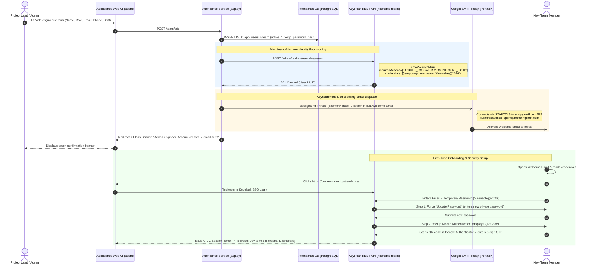

# Keenable Unified Email Notification System
## Technical Architecture, Decoupled Configurations & Step-by-Step Setup Runbook

| Metadata Field | Specification |
| :--- | :--- |
| **Document Version** | 1.0 (Production Reference Manual) |
| **Target Subsystems** | Keycloak (`keenable` Realm) & Attendance Portal (`attendance-service`) |
| **Primary Workflow** | Automated User Provisioning, Credentials Delivery & Onboarding |
| **SMTP Relay** | Google Workspace / Gmail SMTP Relay (`smtp.gmail.com:587`, STARTTLS) |
| **Production Server** | `159.65.155.30` |
| **Operating System** | Ubuntu 24.04 LTS (Containerized via Podman Systemd Quadlets) |
| **Status** | **Architecture Approved & Operational** |

---

## 1. Executive Summary & Objective

In our engineering management ecosystem, three services operate in tandem:
1. **OpenProject**: Project management, work packages, task boards, and roadmaps.
2. **Keycloak**: Centralized Identity & Access Management (IAM), Single Sign-On (SSO), and Two-Factor Authentication (2FA/TOTP).
3. **Attendance Portal**: Daily attendance tracking, leave management, engineer pooling, shift scheduling, and reporting.

### The Objective
Establish a **reliable, automated email notification pipeline** that triggers the moment an engineer account is created. The system must immediately dispatch an onboarding email containing:
* Account Login / Username (Work Email)
* Portal Access Link (`https://pm.keenable.io/attendance/`)
* Temporary Initial Password (`Keenable@2026`)
* Clear 4-Step Instructions: Sign in, Update Password to a private phrase, and configure Google Authenticator / 2FA.

### The Decoupled Configuration Principle
Rather than binding Keycloak and Attendance to OpenProject's internal configuration files (which risks tight coupling, permission conflicts, and cascade failures), the system maintains **3 independent, self-contained copies** of the SMTP relay parameters. Each subsystem has its own configuration file, customized display identity, and autonomous lifecycle.

---

## 2. System Architecture & Topology

```
                                  ┌───────────────────────────┐
                                  │   Google Workspace SMTP   │
                                  │    smtp.gmail.com:587     │
                                  │   (STARTTLS, Port 587)    │
                                  └─────────────▲─────────────┘
                                                │
                                                │ SMTP Auth (oppm@fosteringlinux.com)
            ┌───────────────────────────────────┼───────────────────────────────────┐
            │                                   │                                   │
┌───────────┴─────────────┐         ┌───────────┴─────────────┐         ┌───────────┴─────────────┐
│   Attendance Service    │         │     Keycloak IAM        │         │       OpenProject       │
│  /etc/attendance/       │         │  keenable Realm DB &    │         │  /etc/openproject/      │
│  attendance.env         │         │  /etc/keycloak/smtp.env │         │  openproject.env        │
├─────────────────────────┤         ├─────────────────────────┤         ├─────────────────────────┤
│ From: Keenable Portal   │         │ From: Keenable Identity │         │ From: OpenProject       │
│ User creation welcome,  │         │ Password reset, 2FA     │         │ Work package updates,   │
│ daily digests, leaves   │         │ notifications, actions  │         │ project notifications   │
└─────────────────────────┘         └─────────────────────────┘         └─────────────────────────┘
```

### End-to-End User Creation Sequence



---

## 3. Decoupled Configuration Specifications

To ensure resilience, each subsystem maintains its own configuration file.

### 3.1. Subsystem Configuration Matrix

| Attribute | Attendance Service | Keycloak IAM | OpenProject |
| :--- | :--- | :--- | :--- |
| **Config Location** | `/etc/attendance/attendance.env` | `keenable` Realm DB & `/etc/keycloak/smtp.env` | `/etc/openproject/openproject.env` |
| **Host** | `smtp.gmail.com` | `smtp.gmail.com` | `smtp.gmail.com` |
| **Port** | `587` | `587` | `587` |
| **Security / TLS** | STARTTLS | STARTTLS (`starttls: true`, `ssl: false`) | STARTTLS (`ENABLE_STARTTLS_AUTO=true`) |
| **Username** | `oppm@fosteringlinux.com` | `oppm@fosteringlinux.com` | `oppm@fosteringlinux.com` |
| **Password** | App Password (`bfqzkypnkcmtqrrb`) | App Password (`bfqzkypnkcmtqrrb`) | App Password (`bfqzkypnkcmtqrrb`) |
| **From Address** | `oppm@fosteringlinux.com` | `oppm@fosteringlinux.com` | `oppm@fosteringlinux.com` |
| **Sender Name** | `Keenable Portal` | `Keenable Identity` | `OpenProject` |
| **Primary Use Cases** | New user credentials, daily digest summaries, leave notifications | Password reset links, OTP setup emails, account verification | Work package assignments, project updates, mentions |

---

### 3.2. Dedicated File Contents

#### A. Attendance Service: `/etc/attendance/attendance.env`
Injected into the container via Podman systemd unit (`/etc/containers/systemd/attendance.container`):
```env
# Attendance Email & SMTP Configurations
SMTP_HOST=smtp.gmail.com
SMTP_PORT=587
SMTP_USER=oppm@fosteringlinux.com
SMTP_PASSWORD=bfqzkypnkcmtqrrb
SMTP_FROM=oppm@fosteringlinux.com
SMTP_DISPLAY_NAME=Keenable Portal
BASE_URL=https://pm.keenable.io/attendance
```

#### B. Keycloak Service: `/etc/keycloak/smtp.env` (and Realm DB)
Stored persistently inside Keycloak's PostgreSQL database under the `keenable` realm's `smtpServer` configuration:
```env
# Keycloak Realm SMTP Settings
KEYCLOAK_REALM=keenable
KC_SMTP_HOST=smtp.gmail.com
KC_SMTP_PORT=587
KC_SMTP_FROM=oppm@fosteringlinux.com
KC_SMTP_FROM_DISPLAY_NAME=Keenable Identity
KC_SMTP_AUTH=true
KC_SMTP_USER=oppm@fosteringlinux.com
KC_SMTP_PASSWORD=bfqzkypnkcmtqrrb
KC_SMTP_STARTTLS=true
KC_SMTP_SSL=false
```

#### C. OpenProject Service: `/etc/openproject/openproject.env`
Kept completely standalone in its original configuration:
```env
OPENPROJECT_EMAIL__DELIVERY__METHOD=smtp
OPENPROJECT_SMTP__ADDRESS=smtp.gmail.com
OPENPROJECT_SMTP__PORT=587
OPENPROJECT_SMTP__DOMAIN=fosteringlinux.com
OPENPROJECT_SMTP__AUTHENTICATION=plain
OPENPROJECT_SMTP__USER__NAME=oppm@fosteringlinux.com
OPENPROJECT_SMTP__PASSWORD=bfqzkypnkcmtqrrb
OPENPROJECT_SMTP__ENABLE__STARTTLS__AUTO=true
OPENPROJECT_MAIL__FROM=oppm@fosteringlinux.com
OPENPROJECT_SMTP__SSL=false
```

---

## 4. Step-by-Step Setup Guide

Follow these steps to set up or verify the email notification system from scratch.

### Step 1: Verify Google App Password & Outbound Connectivity
DigitalOcean droplets block outbound traffic on port 25. Therefore, we use **Port 587 with STARTTLS**.

1. Verify that **2-Step Verification** is active on the Google account (`oppm@fosteringlinux.com`).
2. Generate an **App Password**:
   - Google Account Security ➔ 2-Step Verification ➔ App Passwords.
   - App Name: `Keenable Production Services`.
   - Resulting 16-character code: `bfqzkypnkcmtqrrb`.
3. Test connectivity and authentication directly from the host or container:
   ```bash
   podman exec -i attendance python3 -c "
   import smtplib, ssl
   with smtplib.SMTP('smtp.gmail.com', 587, timeout=10) as s:
       s.starttls(context=ssl.create_default_context())
       s.login('oppm@fosteringlinux.com', 'bfqzkypnkcmtqrrb')
       print('SMTP CONNECTIVITY SUCCESSFUL!')
   "
   ```

---

### Step 2: Configure Keycloak Realm SMTP Settings
Keycloak requires SMTP to send password reset links and security alert emails.

1. **Obtain Master Admin Token**:
   ```bash
   TOKEN=$(curl -s -X POST "http://127.0.0.1:8085/auth/realms/master/protocol/openid-connect/token" \
     -d "grant_type=password" \
     -d "client_id=admin-cli" \
     -d "username=admin" \
     -d "password=KeycloakAdmin2026!" | jq -r .access_token)
   ```

2. **Update the `keenable` Realm SMTP Server Configuration**:
   ```bash
   curl -s -X PUT "http://127.0.0.1:8085/auth/admin/realms/keenable" \
     -H "Authorization: Bearer $TOKEN" \
     -H "Content-Type: application/json" \
     -d '{
       "smtpServer": {
         "host": "smtp.gmail.com",
         "port": "587",
         "from": "oppm@fosteringlinux.com",
         "fromDisplayName": "Keenable Identity",
         "auth": "true",
         "user": "oppm@fosteringlinux.com",
         "password": "bfqzkypnkcmtqrrb",
         "starttls": "true",
         "ssl": "false"
       }
     }'
   ```

3. **Verify Configuration**:
   ```bash
   curl -s -X GET "http://127.0.0.1:8085/auth/admin/realms/keenable" \
     -H "Authorization: Bearer $TOKEN" | jq .smtpServer
   ```
   *Expected Result*: Returns JSON object containing the configured host, port, user, and starttls.

---

### Step 3: Implement Asynchronous Email Sender in Attendance (`app.py`)
Because SMTP delivery takes 1.5–3 seconds per message over TLS, sending emails synchronously would freeze the user interface for the Project Manager. We run the email dispatch in an asynchronous background daemon thread.

#### Implementation in `app.py`:

```python
import smtplib, ssl, threading
from email.mime.multipart import MIMEMultipart
from email.mime.text import MIMEText

def send_welcome_email(to_email, name, role, project_name, temp_password):
    """Formats and dispatches the HTML onboarding email via SMTP."""
    if not to_email:
        return

    smtp_host = E("SMTP_HOST", "smtp.gmail.com")
    smtp_port = int(E("SMTP_PORT", "587"))
    smtp_user = E("SMTP_USER", "")
    smtp_password = E("SMTP_PASSWORD", "")
    smtp_from = E("SMTP_FROM", smtp_user or "oppm@fosteringlinux.com")
    from_name = E("SMTP_DISPLAY_NAME", "Keenable Portal")
    base_url = E("BASE_URL", "https://pm.keenable.io/attendance").rstrip("/")
    portal_url = f"{base_url}/"

    subject = "Welcome to Keenable - Your Account Credentials & Onboarding Instructions"

    # Plain Text Fallback
    plain_text = f"""Hello {name},

Welcome to Keenable! Your portal account has been created.

Here are your account details:
--------------------------------------------------
Login / Email:        {to_email}
Portal URL:           {portal_url}
Temporary Password:   {temp_password}
Assigned Project:     {project_name}
Role Title:           {role or 'Software Engineer'}
--------------------------------------------------

First-Time Onboarding Instructions:
1. Navigate to: {portal_url}
2. Sign in with your email and the temporary password above.
3. You will be prompted to update your password to a strong personal password.
4. Set up two-factor authentication (2FA) by scanning the QR code with Google Authenticator.

Important Security Notice:
Please keep these credentials safe and do not share this email. You must change your temporary password immediately upon your first sign in.

Best regards,
Keenable Engineering Team
"""

    # HTML Body with Responsive Styling
    html_body = f"""<!DOCTYPE html>
<html>
<head>
<meta charset="utf-8">
<style>
  body {{ font-family: -apple-system, BlinkMacSystemFont, 'Segoe UI', Roboto, Helvetica, Arial, sans-serif; background: #f1f5f9; margin: 0; padding: 24px; color: #1e293b; }}
  .container {{ max-width: 600px; margin: 0 auto; background: #ffffff; border-radius: 8px; border: 1px solid #e2e8f0; overflow: hidden; box-shadow: 0 4px 6px -1px rgba(0,0,0,0.06); }}
  .header {{ background: #0f172a; padding: 24px 32px; color: #ffffff; }}
  .header h1 {{ margin: 0; font-size: 20px; font-weight: 600; letter-spacing: -0.02em; }}
  .header p {{ margin: 6px 0 0; font-size: 13px; color: #94a3b8; }}
  .content {{ padding: 32px; }}
  .greeting {{ font-size: 16px; font-weight: 600; margin-bottom: 12px; }}
  .intro {{ font-size: 14px; line-height: 1.6; color: #475569; margin-bottom: 24px; }}
  .card {{ background: #f8fafc; border: 1px solid #cbd5e1; border-radius: 6px; padding: 20px; margin-bottom: 24px; }}
  .card table {{ width: 100%; border-collapse: collapse; }}
  .card td {{ padding: 6px 0; font-size: 13px; vertical-align: top; }}
  .card td.label {{ width: 140px; color: #64748b; font-weight: 500; }}
  .card td.val {{ color: #0f172a; font-weight: 600; }}
  .card td.pwd {{ font-family: monospace; font-size: 14px; color: #0284c7; background: #e0f2fe; padding: 4px 8px; border-radius: 4px; display: inline-block; }}
  .steps {{ margin: 24px 0; }}
  .steps h3 {{ font-size: 14px; margin: 0 0 12px; color: #0f172a; }}
  .step-item {{ display: flex; gap: 12px; margin-bottom: 10px; font-size: 13px; line-height: 1.5; color: #334155; }}
  .step-num {{ background: #0284c7; color: #ffffff; width: 20px; height: 20px; border-radius: 50%; display: flex; align-items: center; justify-content: center; font-size: 11px; font-weight: bold; flex-shrink: 0; margin-top: 1px; }}
  .btn-wrap {{ text-align: center; margin: 32px 0 16px; }}
  .btn {{ background: #0284c7; color: #ffffff !important; text-decoration: none; padding: 12px 28px; border-radius: 6px; font-size: 14px; font-weight: 600; display: inline-block; }}
  .footer {{ background: #f8fafc; border-top: 1px solid #e2e8f0; padding: 18px 32px; font-size: 12px; color: #94a3b8; line-height: 1.5; }}
  .footer strong {{ color: #64748b; }}
</style>
</head>
<body>
<div class="container">
  <div class="header">
    <h1>Keenable Attendance & Projects</h1>
    <p>Account Provisioning & Onboarding</p>
  </div>
  <div class="content">
    <div class="greeting">Hello {name},</div>
    <div class="intro">Welcome to the team! Your portal account has been created. You can use this account to track your daily attendance, view project assignments, trends, and manage your leaves.</div>

    <div class="card">
      <table>
        <tr><td class="label">Portal URL:</td><td class="val"><a href="{portal_url}" style="color:#0284c7;text-decoration:none;">{portal_url}</a></td></tr>
        <tr><td class="label">Login / Email:</td><td class="val">{to_email}</td></tr>
        <tr><td class="label">Project:</td><td class="val">{project_name}</td></tr>
        <tr><td class="label">Role:</td><td class="val">{role or 'Software Engineer'}</td></tr>
        <tr><td class="label">Temporary Password:</td><td class="val"><span class="pwd">{temp_password}</span></td></tr>
      </table>
    </div>

    <div class="steps">
      <h3>Getting Started:</h3>
      <div class="step-item"><div class="step-num">1</div><div>Click the button below to open the Keenable Portal login page.</div></div>
      <div class="step-item"><div class="step-num">2</div><div>Sign in with your email and the temporary password provided above.</div></div>
      <div class="step-item"><div class="step-num">3</div><div>Set your strong private password when prompted.</div></div>
      <div class="step-item"><div class="step-num">4</div><div>Set up Mobile Authenticator (2FA) by scanning the QR code with Google Authenticator or Microsoft Authenticator.</div></div>
    </div>

    <div class="btn-wrap">
      <a href="{portal_url}" class="btn">Sign In to Keenable Portal</a>
    </div>
  </div>
  <div class="footer">
    <strong>Security Notice:</strong> Please keep this information secure. You will be required to change your temporary password immediately upon your first sign in. If you did not expect this account, please contact your administrator.
  </div>
</div>
</body>
</html>
"""

    msg = MIMEMultipart("alternative")
    msg["Subject"] = subject
    msg["From"] = f"{from_name} <{smtp_from}>"
    msg["To"] = to_email
    msg.attach(MIMEText(plain_text, "plain", "utf-8"))
    msg.attach(MIMEText(html_body, "html", "utf-8"))

    try:
        with smtplib.SMTP(smtp_host, smtp_port, timeout=20) as server:
            server.starttls(context=ssl.create_default_context())
            if smtp_user and smtp_password:
                server.login(smtp_user, smtp_password)
            server.sendmail(smtp_from, [to_email], msg.as_string())
        app.logger.info("Welcome onboarding email sent to %s", to_email)
    except Exception as ex:
        app.logger.error("Failed to send welcome email to %s: %s", to_email, ex)

def send_welcome_email_async(to_email, name, role, project_name, temp_password):
    """Dispatches the welcome email asynchronously in a non-blocking daemon thread."""
    if not to_email:
        return
    t = threading.Thread(
        target=send_welcome_email,
        args=(to_email, name, role, project_name, temp_password),
        daemon=True,
    )
    t.start()
```

---

### Step 4: Hooking Email Dispatch into `/team/add`

In `app.py`, update `team_add()` to trigger Keycloak provisioning and email dispatch whenever a brand new engineer is added:

```python
        else:
            # Brand new employee
            parts = (name or "").strip().split()
            fn = parts[0] if parts else ""
            ln = " ".join(parts[1:]) if len(parts) > 1 else ""
            temp_pass = E("KEYCLOAK_DEFAULT_TEMP_PASSWORD", "Keenable@2026")
            
            cur = db().execute("""
                INSERT INTO app_users(username, email, name, first_name, last_name, phone, role_title, 
                                      password_hash, must_change_password, totp_enabled, current_project_id, current_shift_start, active)
                VALUES (?, ?, ?, ?, ?, ?, ?, crypt(?, gen_salt('bf', 10)), true, false, ?, ?, 1)
                RETURNING id
            """, (mail.lower() if mail else phone, mail.lower() if mail else "", name, fn, ln, phone, role, temp_pass, pid, shift))
            new_uid = cur.fetchone()["id"]
            
            mid = "m:" + secrets.token_hex(6)
            db().execute("INSERT INTO team(project_id,member_id,name,role,phone,email,shift_start,op_user_id,active,user_id,updated_by,updated_at) VALUES(?,?,?,?,?,?,?,'',1,?,?,?)",
                         (pid, mid, name, role, phone, mail, shift, new_uid, *_stamp()))
            db().commit()

            # 1. Machine-to-Machine Provisioning in Keycloak
            kc_status, _ = keycloak_create_user(mail, name)

            # 2. Asynchronous Welcome & Credentials Email Dispatch
            cp = proj(pid)
            pname = cp["name"] if cp else f"Project {pid}"
            if mail:
                send_welcome_email_async(mail, name, role, pname, temp_pass)
                flash(f"Added {name} to project. Central account created and welcome email sent to {mail}!", "ok")
            else:
                flash(f"Added {name} to project. Central account created! Temporary password: {temp_pass}", "ok")
            return redirect(url_for("team_page", project=pid))
```

---

## 5. Security & Reliability Architecture

1. **Non-Blocking Asynchronous Execution**:
   - Outbound SMTP connections involve DNS lookups, TLS negotiation, authentication, and transmission, taking up to 3 seconds.
   - Using `threading.Thread(daemon=True)` prevents the HTTP request thread from waiting on SMTP. The web UI response returns in milliseconds.
2. **Graceful Fault Tolerance**:
   - If the user enters an invalid email or if Google SMTP is momentarily unreachable, the exception is caught and logged.
   - The user record creation and database transaction are **not rolled back**. The account is still created and the engineer can be assisted manually if needed.
3. **Mandatory First-Time Actions**:
   - The Keycloak user is created with `requiredActions: ["UPDATE_PASSWORD", "CONFIGURE_TOTP"]`.
   - The engineer **cannot access any application data** until they successfully set a private password and enroll in 2FA.
4. **Credential Protection**:
   - Passwords are never logged to container stdout or application log files.
   - Google App Passwords bypass interactive Google SSO without exposing main account credentials.

---

## 6. Verification Runbook & Maintenance

### Automated Test Script
To test the email delivery and user creation pipeline end-to-end:

```bash
# Run test from the production attendance container
podman exec -i attendance python3 -c "
import app
app.send_welcome_email(
    to_email='test.engineer@example.com',
    name='Test Engineer',
    role='Backend Developer',
    project_name='Client Web Portal',
    temp_password='Keenable@2026'
)
"
```

### Password Rotation Runbook
If the Google App Password needs to be rotated in the future:
1. Generate the new 16-character App Password in Google Account settings.
2. Update `/etc/attendance/attendance.env`:
   ```bash
   sed -i 's/SMTP_PASSWORD=.*/SMTP_PASSWORD=new_password/' /etc/attendance/attendance.env
   systemctl restart attendance.service
   ```
3. Update Keycloak Realm SMTP via REST API or `/etc/keycloak/smtp.env`.
4. (Optional) Update `/etc/openproject/openproject.env` if OpenProject password is also rotated.
