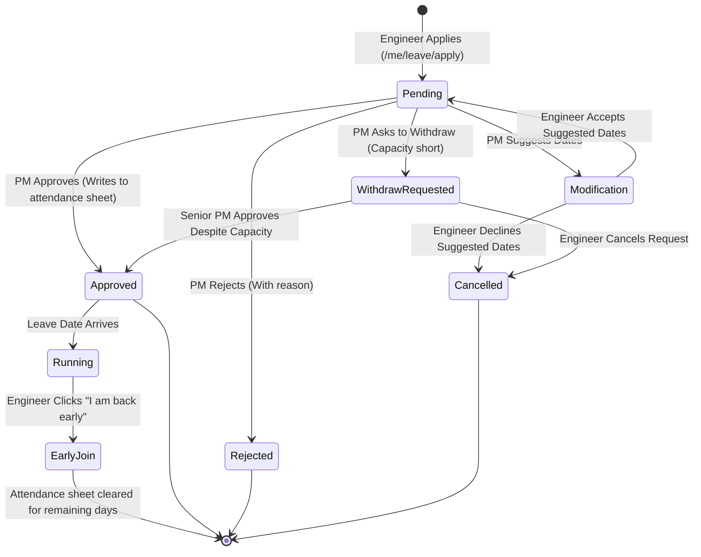
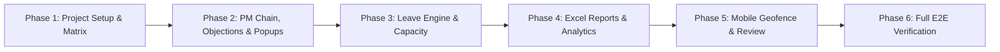

# Master Feature Porting, Micro-Level Architecture & Integration Plan

**Document Version:** 2.0 (Comprehensive Micro-Level Specification)  
**Target Environment:** Local Production-Replica Docker Stack (`localhost:8000`, `openproject-db:5432`, `keycloak:8085`)  
**Base Repository (Target):** `/home/user/Desktop/Projects/management/attendance`  
**Reference / Senior Codebase:** `/home/user/Desktop/Projects/management/attendance-local`  
**Date:** October 21, 2026  

---

## Table of Contents
1. [Executive Summary & Architectural Strategy](#1-executive-summary--architectural-strategy)
2. [Master Feature Matrix & Comparison Inventory](#2-master-feature-matrix--comparison-inventory)
3. [Micro-Level Feature Specification: Attendance Objections & Grievance Engine](#3-micro-level-feature-specification-attendance-objections--grievance-engine)
4. [Micro-Level Feature Specification: PM Chain Hierarchy & Dynamic Leave Bypass](#4-micro-level-feature-specification-pm-chain-hierarchy--dynamic-leave-bypass)
5. [Micro-Level Feature Specification: Dual SLA Escalation & Miss Analytics](#5-micro-level-feature-specification-dual-sla-escalation--miss-analytics)
6. [Micro-Level Feature Specification: Real-Time In-App Forced Popups & Email System](#6-micro-level-feature-specification-real-time-in-app-forced-popups--email-system)
7. [Micro-Level Feature Specification: Leave Lifecycle, Capacity Guardrails & Extension Engine](#7-micro-level-feature-specification-leave-lifecycle-capacity-guardrails--extension-engine)
8. [Micro-Level Feature Specification: Management Leave Reports & 6-Sheet Excel Workbook](#8-micro-level-feature-specification-management-leave-reports--6-sheet-excel-workbook)
9. [Micro-Level Feature Specification: Project Metadata, Weekly-Off Matrix & Client Officers](#9-micro-level-feature-specification-project-metadata-weekly-off-matrix--client-officers)
10. [Micro-Level Feature Specification: Mobile Geofenced Check-in, Telemetry & Review](#10-micro-level-feature-specification-mobile-geofenced-check-in-telemetry--review)
11. [Base Features Preserved & Unified Grid Integration](#11-base-features-preserved--unified-grid-integration)
12. [Defects Identified in Senior's Code & Remediation Architecture](#12-defects-identified-in-seniors-code--remediation-architecture)
13. [Phased Implementation Roadmap & Verification Plan](#13-phased-implementation-roadmap--verification-plan)

---

## 1. Executive Summary & Architectural Strategy

We have conducted an exhaustive, line-by-line micro-level technical audit of the senior's codebase (`/attendance-local`) alongside our existing base codebase (`/attendance`).

### Strategy: Option 1 (Our Base + Modular Porting)
* **Foundation:** Our base codebase retains 100% data integrity with the production-grade PostgreSQL 17 database replica, authentic user accounts, Keycloak SSO integration, tamper-proof post-approval locking, and the rich daily management grid (`entry.html`).
* **Porting Scope:** Every modular enhancement from the senior's codebase—including **Attendance Objections/Grievances**, **PM Chain Hierarchy**, **SLA Escalations**, **Real-time Forced Popups**, **Full Leave Lifecycle with Capacity Guardrails**, **6-Sheet Excel Audit Reports**, **Project/Client/Weekly-Off Setup**, and **Mobile Geofenced Check-in**—will be ported modularly.
* **Bug Fixes:** All 7 critical and moderate defects found in the senior's implementation will be fixed during the porting phases.

```mermaid
flowchart TD
    subgraph Base Foundation [Our Base Codebase: /attendance]
        DB[(Production Postgres Replica)]
        AUTH[Keycloak SSO & Auth]
        GRID[Daily Attendance Grid entry.html]
        LOCK[Tamper-Proof Post-Approval Locking]
        AUDIT[Direct Audit Schema on attendance]
    end

    subgraph Senior Modules to Port [Modules from /attendance-local]
        M1["1. Objection & Grievance Engine (/me/objection & /approvals)"]
        M2["2. PM Chain Hierarchy & Auto Leave Bypass (workflow.py)"]
        M3["3. Dual SLA Timers & Miss Tracking (24h/30h)"]
        M4["4. Real-time In-App Forced Popups & SMTP (notice table)"]
        M5["5. Leave Engine & Capacity Guardrails (leaves.py)"]
        M6["6. 6-Sheet Management Excel Reports (/leaves/report.xlsx)"]
        M7["7. Project Setup & Weekly-Off Matrix (/project/setup)"]
        M8["8. Mobile Geofencing & Review Screen (mobile.py)"]
    end

    M1 --> Base Foundation
    M2 --> Base Foundation
    M3 --> Base Foundation
    M4 --> Base Foundation
    M5 --> Base Foundation
    M6 --> Base Foundation
    M7 --> Base Foundation
    M8 --> Base Foundation
```

---

## 2. Master Feature Matrix & Comparison Inventory

| Module / Feature | In Our Base (`/attendance`) | In Senior's (`/attendance-local`) | Integration Action | Key Technical Distinction |
| :--- | :--- | :--- | :--- | :--- |
| **Attendance Objections** | ❌ Missing | ✅ Full feature (`/me/objection`, `/approvals`) | **PORT FULLY** | Engineer disputes past locked days; PM accepts & overwrites attendance or rejects. |
| **PM Chain Hierarchy** | Single-tier lead | 4-tier chain (`PM0`..`PM3`) with leave bypass | **PORT FULLY** | Automatically routes approvals to lowest available PM not on leave. |
| **Attendance SLA (24h)** | ❌ Missing | Auto-escalation to Admin + miss log | **PORT & OPTIMIZE** | Replaces full table scans with indexed event-driven queries. |
| **Leave SLA (30h)** | ❌ Missing | Multi-tier escalation up PM chain | **PORT FULLY** | Moves request 1 level up if not decided within configurable hours. |
| **Real-time Forced Popups** | Flash messages only | 8-second polling + mandatory ACK modal | **PORT FULLY** | Un-dismissible modal with async SMTP background email notifications. |
| **Leave Lifecycle Engine** | Advance leave modal | Full state machine in `leaves.py` | **PORT FULLY** | Apply, cancel, early join, suggest dates, ask to withdraw, extension linking. |
| **Capacity Guardrails** | ❌ Missing | Live quota check + PM warning modal | **PORT FULLY** | Enforces minimum headcount (default 60%); escalates approval when breached. |
| **Management Excel Export** | Monthly summary | 6-Sheet OpenPyXL Workbook | **PORT FULLY** | Detailed multi-sheet audit: Capacity, Late, Extensions, Early, Mix, Withdraws. |
| **Project Setup & Matrix** | Basic table | `/project/setup` (info, weekly-off, officers) | **PORT FULLY** | Custom weekly-off matrix per engineer (`team.weekly_off`) + client officers. |
| **Mobile Check-in Telemetry** | ❌ Missing | Geofenced events + `/review` screen | **PORT FULLY** | Haversine distance, dwell filtering, Wi-Fi/Bluetooth beacons, device trust. |
| **Tamper-Proof Locking** | ✅ Complete | ⚠️ Soft prompt only | **KEEP OURS** | Input controls completely disabled once approved; server rejects edits. |
| **Self-Entry Rich Fields** | ✅ Complete | ⚠️ Basic form (In/Out only) | **KEEP OURS** | Includes `duty_status` (*Present / Half Day*), `handled_by`, worked/short hours. |
| **Daily Grid Integration** | ✅ Complete | ⚠️ Separate screens | **KEEP OURS** | 1-click bulk approvals & inline reject modals directly on `entry.html`. |

---

## 3. Micro-Level Feature Specification: Attendance Objections & Grievance Engine

### 3.1 Business Purpose & Problem Solved
Once an attendance record is approved (by a PM/TL or automatically via phone sync), the record is locked to prevent unauthorized tampering. When an engineer discovers an error (e.g., incorrect punch time, forgot to punch, system error), they cannot edit the record directly. Instead, they raise an official **Objection / Grievance**.

```mermaid
sequenceDiagram
    autonumber
    actor Eng as Engineer
    participant Me as /me (Engineer Portal)
    participant DB as PostgreSQL Database
    participant PM as /approvals (PM Dashboard)
    actor Lead as Project Manager / TL

    Eng->>Me: Fills objection (Date, Body, Req IN, Req OUT)
    Me->>DB: INSERT INTO objection (status='open')
    Me->>DB: INSERT INTO notice (notify PM chain & Leads)
    Note over Me,DB: Async SMTP email dispatched in background
    Lead->>PM: Views "Engineer objections" table
    alt PM Accepts Objection
        Lead->>PM: Clicks "Accept and apply times" (with reply)
        PM->>DB: UPDATE attendance (in_time, out_time, remarks='Corrected after objection')
        PM->>DB: UPDATE objection (status='accepted', closed_by, closed_at, applied)
        PM->>DB: INSERT INTO notice (notify Engineer)
        PM-->>Eng: In-App Notice: "Objection accepted; corrected to IN... / OUT..."
    else PM Rejects Objection
        Lead->>PM: Clicks "Reject" (with mandatory reply reason)
        PM->>DB: UPDATE objection (status='rejected', closed_by, closed_at)
        PM->>DB: INSERT INTO notice (notify Engineer)
        PM-->>Eng: In-App Notice: "Objection rejected: [Reason]"
    end
    Eng->>Me: Views updated Objection status pill & PM comments
```

### 3.2 Database Schema (`objection`)
```sql
CREATE TABLE IF NOT EXISTS objection (
    id SERIAL PRIMARY KEY,
    day TEXT NOT NULL,
    user_id TEXT NOT NULL,
    email TEXT NOT NULL,
    project_id TEXT NOT NULL,
    body TEXT NOT NULL,
    status TEXT NOT NULL DEFAULT 'open', -- 'open' | 'accepted' | 'rejected'
    req_in TEXT,
    req_out TEXT,
    reply TEXT,
    applied TEXT,
    created_at TEXT NOT NULL,
    closed_by TEXT,
    closed_at TEXT
);
CREATE INDEX IF NOT EXISTS obj_user_day ON objection(user_id, day);
CREATE INDEX IF NOT EXISTS obj_status ON objection(status, project_id);
```

### 3.3 Micro-Workflows & Routes
1. **Engineer Submission (`POST /me/objection`):**
   * **Payload:** `day` (ISO date $\le \text{today}$), `body` (text up to 500 chars), `req_in` (`HH:MM` optional), `req_out` (`HH:MM` optional), `csrf`.
   * **Backend Validations:**
     * Validates engineer belongs to active project team.
     * Validates date is not in future.
     * Validates `req_in` and `req_out` are valid `HH:MM` time strings if provided.
     * Rejects empty `body`.
   * **Actions:**
     * Inserts into `objection`.
     * Calls `notify(project_people(project_id), 'objection', 'Attendance objection from ' || member_name, body, '/approvals')`.
     * Dispatches async background email.
2. **PM Resolution (`POST /approvals/objection/reply`):**
   * **Payload:** `id` (objection ID), `action` (`accept` | `reject`), `in` (time string), `out` (time string), `reply` (mandatory comment up to 500 chars), `csrf`.
   * **Authorization:** Verified that caller is `admin`, project lead, or belongs to `pm_chain` for that project.
   * **Acceptance Logic (`action == 'accept'`):**
     * Validates time strings.
     * Verifies OUT is after IN (unless night shift).
     * Inserts or updates `attendance`: sets `in_time`, `out_time`, `remarks = 'Corrected after objection'`, `updated_by = pm_email`, `updated_at = stamp()`.
     * Sets `objection.applied = 'IN ' || in || ' / OUT ' || out`.
     * Sets `objection.status = 'accepted'`, `closed_by = pm_email`, `closed_at = stamp()`.
     * Notifies engineer via `notice` table + SMTP email.
   * **Rejection Logic (`action == 'reject'`):**
     * Sets `objection.status = 'rejected'`, `closed_by = pm_email`, `closed_at = stamp()`.
     * Notifies engineer with rejection comment.
3. **Engineer Visibility (`templates/me.html`):**
   * Renders objection history table showing: Day, Objection Details (body + requested IN/OUT), Status Pill (`Waiting for TL/PM` [Amber], `Accepted` [Green], `Rejected` [Red]), and PM Reply + Applied times.

---

## 4. Micro-Level Feature Specification: PM Chain Hierarchy & Dynamic Leave Bypass

### 4.1 Chain Architecture
* **Levels:** `PM0` (Top / Executive), `PM1` (Lead PM), `PM2` (Senior TL), `PM3` (Associate TL).
* **Storage:** `pm_chain(project_id TEXT, level INTEGER, email TEXT, PRIMARY KEY(project_id, level))`.
* **Subproject Inheritance:** If a subproject has no explicit chain, `chain(pid)` automatically inherits the chain from its `parent_project_id`.

```mermaid
flowchart TD
    Req[New Attendance or Leave Request] --> CheckL3{Is PM3 on Leave?}
    CheckL3 -- No --> RouteL3[Assign to PM3]
    CheckL3 -- Yes --> CheckL2{Is PM2 on Leave?}
    CheckL2 -- No --> RouteL2[Assign to PM2]
    CheckL2 -- Yes --> CheckL1{Is PM1 on Leave?}
    CheckL1 -- No --> RouteL1[Assign to PM1]
    CheckL1 -- Yes --> RouteL0[Assign to PM0 (Top of Chain)]
```

### 4.2 Dynamic Leave Bypass Algorithm (`approver_for`)
```python
def on_leave(email, day):
    """Returns True if the PM has an approved leave_type recorded in attendance for 'day'."""
    if not email: return False
    for t in db().execute("SELECT member_id FROM team WHERE lower(email)=?", (email.lower(),)):
        a = db().execute("SELECT leave_type FROM attendance WHERE day=? AND user_id=?", (day, t["member_id"])).fetchone()
        if a and (a["leave_type"] or "").strip(): return True
    return False

def approver_for(pid, day):
    """Selects the lowest-level PM (PM3 -> PM2 -> PM1 -> PM0) who is NOT on leave on 'day'."""
    ch = chain(pid)
    if ch:
        for _, em in sorted(ch, reverse=True): # Starts from highest level number (lowest rank)
            if not on_leave(em, day): return em
        return ch[0][1] # Fallback to PM0 if everyone is away
    # Fallback to project leads if no chain configured
    leads = [r["email"].lower() for r in db().execute("SELECT email FROM project_access WHERE project_id=? AND kind='lead' ORDER BY email", (str(pid),))]
    for em in leads:
        if not on_leave(em, day): return em
    return leads[0] if leads else ""
```

---

## 5. Micro-Level Feature Specification: Dual SLA Escalation & Miss Analytics

### 5.1 Attendance SLA Engine (24-Hour Default)
* **Configuration:** Managed via `meta` key `approval_hours` (1–240 hours) via `/approvals/settings`.
* **Execution:** Executed during approval cycle.
* **Escalation Rules:**
  * When `now() > due_at` on a pending attendance row:
  * Sets `approval.status = 'escalated'`, `approval.escalated_at = stamp()`.
  * Logs breach in `approval_miss(approver, project_id, day, user_id, missed_at)`.
  * Escalated items become strictly manageable by `admin`.
* **Miss Analytics Table (`/approvals`):** Aggregates misses per approver with columns: `Approver`, `Project`, `Last 30 Days Misses`, `All-Time Misses`.

### 5.2 Leave SLA Engine (30-Hour Default)
* **Configuration:** Managed via `meta` key `leave_approval_hours` (1–240 hours) via `/leaves/settings`.
* **Escalation Rules:**
  * When `now() > due_at` on a pending leave request:
  * Computes `above = one_above(project_id, assigned_to)`.
  * Logs breach in `leave_miss(request_id, approver, project_id, missed_at, escalated_to)`.
  * Updates `leave_request`: sets `assigned_to = above`, resets `due_at = now + hours`, increments `escalations = escalations + 1`.
  * Dispatches `notice` and email alerts to `above` PM, Admins, and the defaulting approver.

---

## 6. Micro-Level Feature Specification: Real-Time In-App Forced Popups & Email System

### 6.1 Architecture & Polling Mechanism
* **Database Schema (`notice`):**
  ```sql
  CREATE TABLE IF NOT EXISTS notice (
      id SERIAL PRIMARY KEY,
      email TEXT NOT NULL,
      kind TEXT,         -- 'objection' | 'leave' | 'attendance' | 'system'
      title TEXT NOT NULL,
      body TEXT NOT NULL,
      link TEXT,
      created_at TEXT NOT NULL,
      acked_at TEXT
  );
  CREATE INDEX IF NOT EXISTS notice_open ON notice(email, acked_at);
  ```
* **Frontend Poller (`base.html`):**
  * JavaScript executes every 8000ms: `GET /wf/notices` with credentials.
  * When unacknowledged notices exist, displays full-screen backdrop modal (`#wfn`).
  * Modal lists each notice title, body (with line breaks preserved), timestamp, and deep link.
  * User must click **"Acknowledge"** button which triggers `POST /wf/notices/ack` passing notice IDs.
  * Modal cannot be closed or bypassed without acknowledgment.

### 6.2 Asynchronous SMTP Email Dispatcher
* **Threaded Non-Blocking:** Dispatches emails inside daemon threads `threading.Thread(target=go, daemon=True)` so HTTP requests never block.
* **Security & Fallback:** Uses STARTTLS on port 587 (or custom `SMTP_PORT`), UTF-8 encoding, and graceful error logging if SMTP is unreachable.

---

## 7. Micro-Level Feature Specification: Leave Lifecycle, Capacity Guardrails & Extension Engine

### 7.1 Leave Rules & Auto-Classification
* **3-Day Planned Rule (`LEAVE_PLANNED_DAYS`):** If $(\text{from\_date} - \text{today}) \ge \text{pdays}$, classified as `Planned`; otherwise `Unplanned`. PM can override classification upon approval.
* **Maximum Duration:** Limited to 60 days per request.
* **Weekly-Off Aware:** Only counts working days based on `work_days(user_id, from, to)`.

### 7.2 Capacity Quota Engine (`check_capacity`)
* **Quota Calculation:** Looks up `project_info.min_capacity`. If unset, defaults to $\lceil \text{Active Roster} \times 60\% \rceil$.
* **Capacity Breach Detection:**
  * For each working day in the requested leave span: calculates $(\text{Working Members} - \text{Already Away} - \text{Applicant})$.
  * If available headcount drops below minimum threshold, flags `capacity_full = 1` and records breach dates in `cap_days`.
  * **Routing Impact:** Leaves with capacity breach bypass normal approver and are assigned directly to `one_above(pid, normal_approver)`.
  * **PM Constraints:** Lower PMs cannot approve breached leaves (Approve button disabled with tooltip); they can only Reject, Suggest other dates, or Ask engineer to withdraw.



### 7.3 Leave Action Endpoints
1. **Live AJAX Pre-Application Check (`GET /me/leave/check`):**
   * Returns JSON with overlapping teammates (`others`) and capacity shortage warnings (`text`).
2. **Back-to-Back Leave Extension:**
   * Detects if new leave starts immediately after an approved leave (only weekly-off days in between). Sets `is_extension = 1` and links `ext_of = prev_id`.
3. **Early Join (`POST /me/leave/early`):**
   * Sets `early_join = today`, clears future placeholder days from `attendance` table, updates `to_date = today` (resolving Bug 6), and notifies team.
4. **Date Suggestion & Acceptance (`POST /me/leave/answer`):**
   * Allows PM to propose alternative dates; engineer accepts or declines with 1-click on `/me`.

---

## 8. Micro-Level Feature Specification: Management Leave Reports & 6-Sheet Excel Workbook

### 8.1 Web Report Interface (`/leaves/report`)
* Filters by Project and Date Range.
* Renders 6 distinct data tables:
  1. **Capacity Shortages:** Days where active attendance fell below minimum requirement.
  2. **Approval Overdues:** Approvals that breached the 30h SLA.
  3. **Leave Extensions:** Back-to-back extension requests.
  4. **Early Joins:** Engineers who resumed duty before leave ended.
  5. **Planned vs Unplanned Breakdown:** Total days per engineer categorized by planned/unplanned.
  6. **Withdrawal Requests:** Leaves where withdrawal was requested due to capacity constraints.

### 8.2 Multi-Sheet OpenPyXL Workbook (`/leaves/report.xlsx`)
Generates a downloadable `.xlsx` workbook with 6 formatted sheets:
* `Capacity short` $\rightarrow$ Project, Day, Total Roster, Away, Available, Minimum, Pending.
* `Approval overdue` $\rightarrow$ Project, Engineer, Leave Span, Approver, Escalated To, Missed At.
* `Extensions` $\rightarrow$ Project, Engineer, Original Span, Extension Span, Status.
* `Early joins` $\rightarrow$ Project, Engineer, Leave Span, Resumed On.
* `Planned vs unplanned (days)` $\rightarrow$ Project, Engineer, Planned Days, Unplanned Days.
* `Withdraw requests` $\rightarrow$ Project, Engineer, Leave Span, Status.

---

## 9. Micro-Level Feature Specification: Project Metadata, Weekly-Off Matrix & Client Officers

### 9.1 Project Metadata (`project_info`)
* Fields: `owner_name`, `owner_email`, `owner_phone`, `location`, `lat`, `lon`, `min_capacity`, `weekly_off`.
* Allows PM/TL to define site address, geolocation coordinates, custom capacity limits, and project-default days off.

### 9.2 Custom Weekly-Off Matrix (`team.weekly_off`)
* Stored as comma-separated days (e.g. `sat,sun` or `mon,tue`) per team member.
* Directly integrated with `off_days(uid)` helper across attendance calculations, leave day counting, monthly exports, and daily roster views.

### 9.3 Client Reporting Officers (`client_officer`)
* Maps each engineer in a project to their specific client-side reporting officer (Name, Email, Phone).
* Displayed on team pages and exported in client compliance audits.

---

## 10. Micro-Level Feature Specification: Mobile Geofenced Check-in, Telemetry & Review

### 10.1 Geofencing & Work Sites (`site`)
* Coordinates: Latitude, Longitude, Radius ($200-300\text{m}$, configurable $5-5000\text{m}$).
* Dwell Times: `dwell_in` (arrival wait 1–60 min), `dwell_out` (departure wait 1–120 min) to filter out transient drive-bys.
* Beacon Verification: Wi-Fi BSSID or Bluetooth MAC checking (`off`, `any`, `all`). Includes "Use my location" HTML5 Geolocation browser integration.

### 10.2 Device Security & Anti-Spoofing Engine (`judge`)
* **PKCE Bearer Token Validation:** Authenticates tokens issued to `attendance-mobile` client in Keycloak.
* **Anti-Spoofing Checks:**
  * Rejects Mock Locations (`mock = true`).
  * Rejects Low Accuracy ($> 100\text{m}$).
  * Flags Rooted Devices or Developer Mode.
  * Flags Impossible Travel Speed ($> 200\text{ km/h}$ between consecutive events).
  * Flags Events on Approved Leave Days.
* **Privacy Data Retention:** Automatically purges raw coordinates older than 90 days (`purge_events()`) while preserving derived IN/OUT times.

### 10.3 Review Dashboard (`/review`)
* Side-by-side comparison of Phone IN/OUT vs Sheet IN/OUT.
* Displays exit counts and total break minutes.
* 1-Click **"Use phone times"** button to accept mobile punch.
* Device approval queue for new/replaced phones.
* Dispute resolution queue.

---

## 11. Base Features Preserved & Unified Grid Integration

1. **Authentic Production Replica:** Stack strictly maintained against local PostgreSQL 17 Docker container with real production users, teams, and Keycloak SSO clients.
2. **Unified Daily Management Grid (`entry.html`):** Project tab pending badges, 1-click **"Approve All Submitted"** button, and inline **"✕ Reject"** modal with mandatory reason prompt.
3. **Strict Tamper-Proof Post-Approval Locking:** UI controls completely disabled on `/me` once approved; backend rejects unauthorized modifications.
4. **Rich Self-Entry Form:** Full support for `duty_status` (*Present / Half Day*), `handled_by` (cover colleague), and worked/short hour calculations against shift targets (8.5h full / 4.25h half).
5. **Direct Audit Schema on `attendance` Table:** Direct columns `approval_status`, `submitted_by`, `approved_by`, `approved_at`, `rejection_reason`, and `duty_status`.

---

## 12. Defects Identified in Senior's Code & Remediation Architecture

| # | Component | Defect in Senior's Code | Remediation in Our Integration |
| :- | :--- | :--- | :--- |
| **1** | `workflow.py:248` | **Attendance Rejection Disconnect:** Rejecting in `/approvals` updated `approval` table but left `attendance` untouched. Reports still counted engineer as Present. | Wire rejection to `attendance.approval_status = 'Rejected'`, clear in/out times or flag unapproved, unlock form on `/me` with red rejection alert banner. |
| **2** | `workflow.py:98` | **$O(N)$ 14-Day Table Scan:** Scanned all attendance rows across the entire database on every visit to `/approvals`. | Replace full scan with indexed event-driven queries (`WHERE approval_status='Pending'`). |
| **3** | `workflow.py:306` | **Missing `duty_status`:** Self-entry form omitted Half Day / WFH status. | Preserve our `duty_status` dropdown and calculate worked/short hours against half-day shifts (4.25h). |
| **4** | `leaves.py:199` | **Missing Cover Colleague (`handled_by`):** Leave application lacked cover teammate field. | Add `handled_by` teammate selector in leave form and populate in `attendance.handled_by` upon approval. |
| **5** | `leaves.py:125` | **Fragile `clear_days` String Match:** Deleted rows matching `remarks LIKE 'Leave #5:%'`, breaking if PM modified remarks. | Delete rows matching `user_id` and leave date range directly, or tag with explicit `leave_request_id`. |
| **6** | `leaves.py:209` | **Overlapping Leave Block after Early Join:** Returning early on Day 3 of 5-day leave left `to_date` as Day 5, blocking new leave on Day 4. | Update `leave_request.to_date = early_join` upon early return submission. |
| **7** | `app.py:388` | **Case Sensitivity in Access Queries:** Query used `email=?` instead of `lower(email)=?`. | Use `lower(email)=?` across all database lookups to prevent case mismatch. |

---

## 13. Phased Implementation Roadmap & Verification Plan



### Phase 1: Project Metadata & Weekly-Off Setup
* Port `project_info`, `client_officer`, and `team.weekly_off` into `app.py`.
* Port `templates/project_setup.html` and link in navigation for Admins and Leads.
* Add `off_days(uid)` helper and verify weekly-off calculations across sheets and trends.

### Phase 2: PM Chain Hierarchy, Objections Engine & In-App Popups
* Port `pm_chain`, `approval_miss`, `leave_miss`, and `notice` tables.
* Implement `approver_for()` dynamic routing with automatic leave bypass.
* Port `/me/objection` grievance raise workflow and PM resolution on `/approvals` (*Accept & Apply Times* vs *Reject*).
* Port `/wf/notices` 8s polling script and mandatory acknowledgment modal into `templates/base.html`.

### Phase 3: Leave Engine, Capacity Guardrails & Application UI
* Port `leaves.py` and `templates/leaves.html`.
* Port leave card on `/me` with live pre-application visibility (`/me/leave/check`) and capacity warning popup.
* Integrate missing `handled_by` (cover colleague) dropdown.
* Implement 3-day Planned/Unplanned classification, extension linking, early returns, and date negotiation.

### Phase 4: Leave Audit Reports & Multi-Sheet Excel Export
* Port `templates/leave_report.html` and `/leaves/report`.
* Port `/leaves/report.xlsx` generating 6-sheet OpenPyXL Excel audit workbook.

### Phase 5: Mobile Geofenced Check-in & Review Dashboard
* Port `mobile.py`, work site geofencing (`_site_fields.html`), and `/review` comparison screen.

### Phase 6: Automated End-to-End Test Suite Verification
* Run end-to-end Python test suite against the local PostgreSQL Docker container verifying all 8 modules, ensuring 100% test pass rate and zero regressions.
