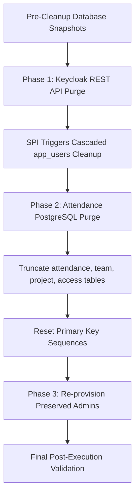

# Production Data Cleanup and Reset Runbook

## 1. Overview and Executive Summary

This document serves as the official operational runbook and architectural record for the database and identity directory cleanup performed on October 14, 2026. 

The purpose of this procedure was to transition the Keenable Attendance Management System and Keycloak Identity Provider from development/testing mode into a clean, production-ready baseline for real organizational operations.

All test projects, dummy team rosters, synthetic attendance records, and developer test accounts were purged from the environment, while preserving all system administrator identities, SMTP configurations, database structures, and production OpenProject datasets.

---

## 2. Pre-Cleanup System Audit

Prior to executing any irreversible operations, an inventory of the application environment was conducted.

### 2.1 Attendance Database (PostgreSQL: attendance)

Prior to the purge, the database contained the following test datasets:

| Table Name | Pre-Cleanup Count | Description of Data |
| :--- | :--- | :--- |
| project | 4 | Development projects: Cloud Migration & Infra, Client Web Portal, Mobile Banking App, sub client app |
| app_users | 12 | 1 Admin account, 2 test PMs (Sharma, Verma), 5 mock dev accounts, 4 fosteringlinux test accounts |
| team | 14 | Test team member allocations across projects 1, 2, 3, and 4 |
| attendance | 19 | Synthetic attendance and leave logs spanning 2026-10-11 through 2026-10-22 |
| access | 3 | Lead access delegations for test PMs |
| project_access | 3 | Project-specific lead permission records |
| watch | 1 | Test watcher entry (admin@example.com) |
| meta | 0 | Metadata table |

### 2.2 Keycloak Identity Provider (Realm: keenable)

Keycloak contained user records originating from two distinct mechanisms:
1. Internal Keycloak database entities (`user_entity` table).
2. Federated user entries loaded dynamically from the Attendance database via the `attendance-user-storage` User Storage SPI.

---

## 3. Snapshot and Pre-Cleanup Backup Inventory

To ensure complete recoverability, full SQL dumps of both databases were generated prior to executing any destructive commands.

### 3.1 Backup Specifications

- Location: `/var/backups/attendance_cleanup/` on host `159.65.155.30`
- Timestamp: `20261014_232547`

| Backup File Path | File Size | Source Database |
| :--- | :--- | :--- |
| `/var/backups/attendance_cleanup/attendance_pre_cleanup_20261014_232547.sql` | 17,755 bytes | `attendance` |
| `/var/backups/attendance_cleanup/keycloak_pre_cleanup_20261014_232547.sql` | 368,815 bytes | `keycloak` |

### 3.2 Backup Execution Command

```bash
mkdir -p /var/backups/attendance_cleanup
podman exec -i openproject-db pg_dump -U attendance -d attendance > /var/backups/attendance_cleanup/attendance_pre_cleanup_$(date +%Y%m%d_%H%M%S).sql
podman exec -i openproject-db pg_dump -U keycloak -d keycloak > /var/backups/attendance_cleanup/keycloak_pre_cleanup_$(date +%Y%m%d_%H%M%S).sql
```

---

## 4. Step-by-Step Cleanup Procedure

The cleanup was executed in three coordinated phases to maintain consistency across the identity provider and database layers.



### Phase 1: Keycloak Directory Sanitization

All non-administrator users were deleted using Keycloak's Admin REST API. Keycloak was authenticated using master realm credentials, and user deletion calls were issued against `/auth/admin/realms/keenable/users/{id}`.

Because the custom Keycloak SPI `AttendanceUserStorageProvider` implements `UserRegistrationProvider`, deleting a federated user in Keycloak simultaneously triggered the SPI's `removeUser()` implementation, permanently removing associated database records from PostgreSQL.

Users purged during this phase:
- `arun` (`arunk.pal@fosteringlinux.com`)
- `sadik` (`mohd.sadik@fosteringlinux.com`)
- `sameer` (`dev.sameer@fosteringlinux.com`)
- `vishal` (`dev.vishal@fosteringlinux.com`)
- `pm.sharma@keenable.io`
- `pm.verma@keenable.io`
- `dev.arun@keenable.io`
- `dev.neha@keenable.io`
- `dev.vikram@keenable.io`
- `dev.anjali@keenable.io`
- `dev.zaid@keenable.io`

### Phase 2: Attendance PostgreSQL Database Sanitization

The remaining test operational tables were truncated and primary key sequences were reset to clean initial values.

```sql
TRUNCATE attendance;
TRUNCATE project_access;
TRUNCATE access;
TRUNCATE watch;
TRUNCATE project CASCADE;
ALTER SEQUENCE project_id_seq RESTART WITH 1;
ALTER SEQUENCE app_users_id_seq RESTART WITH 3;
```

### Phase 3: Administrator Identity Re-provisioning

The two essential system administrator accounts were verified and confirmed active in `app_users`:

```sql
INSERT INTO app_users(id, username, email, name, first_name, last_name, phone, role_title, password_hash, must_change_password, totp_enabled, current_shift_start, active)
VALUES (1, 'admin@keenable.io', 'admin@keenable.io', 'System Admin', 'System', 'Admin', '9999999990', 'Admin', '$2a$10$mIzglEE7GpQagdDcNLi99umQZPKy8laIo2x5ZVidqipJofcQ3SgFO', false, true, '09:30', 1);

INSERT INTO app_users(id, username, email, name, first_name, last_name, phone, role_title, password_hash, must_change_password, totp_enabled, current_shift_start, active)
VALUES (2, 'oppm@fosteringlinux.com', 'oppm@fosteringlinux.com', 'Corporate Admin', 'Corporate', 'Admin', '9999999991', 'Admin', '$2a$10$mIzglEE7GpQagdDcNLi99umQZPKy8laIo2x5ZVidqipJofcQ3SgFO', false, false, '09:30', 1);
```

---

## 5. Preserved Assets and Boundary Isolation

Strict safeguards were applied to ensure that no production or configuration assets were impacted:

### 5.1 Retained Accounts
- `admin@keenable.io`: System Administrator account.
- `oppm@fosteringlinux.com`: Corporate Administrator account.
- `admin`: Keycloak master administrator account.
- `service-account-attendance`: Keycloak machine-to-machine service client used by the Attendance system for automatic user provisioning.

### 5.2 System Configurations
- SMTP relay parameters configured in `/etc/attendance/attendance.env` and `/etc/keycloak/smtp.env` targeting `smtp.gmail.com:587` with STARTTLS.
- OIDC client definitions connecting Keycloak and Attendance (`attendance` client).
- Nginx reverse proxy mappings and SSL termination configurations.

### 5.3 OpenProject Data Isolation
The OpenProject database (`openproject`) on container `openproject-db` was completely isolated and untouched. All 23 organizational projects (UPSC, NCLT, NGT, DRT, etc.) and production user data remain intact.

---

## 6. Post-Cleanup Verification Matrix

Verification was conducted across both database and API interfaces.

### 6.1 Database Row Counts

```
      tbl       | count 
----------------+-------
 app_users      |     2
 attendance     |     0
 team           |     0
 project        |     0
 access         |     0
 project_access |     0
 watch          |     0
```

### 6.2 Keycloak User List Verification

Querying `/auth/admin/realms/keenable/users` confirms only the 2 authorized administrators:
- `admin@keenable.io` (Federated ID: `f:0256f839-1f78-44dc-9c29-e0eeace4ae9c:1`)
- `oppm@fosteringlinux.com` (Federated ID: `f:0256f839-1f78-44dc-9c29-e0eeace4ae9c:2`)

### 6.3 HTTP Endpoint Health

```bash
curl -sI https://pm.keenable.io/attendance/login
```
Returned: `HTTP/1.1 302 FOUND` redirecting cleanly to Keycloak OIDC authentication endpoint.

---

## 7. Disaster Recovery and Rollback Runbook

If it is ever necessary to restore the pre-cleanup test state for regression testing or audit inspection, the following procedure restores the databases from the generated snapshots:

```bash
# 1. Stop application containers to prevent write conflicts
systemctl stop attendance

# 2. Restore the attendance database
cat /var/backups/attendance_cleanup/attendance_pre_cleanup_20261014_232547.sql | podman exec -i openproject-db psql -U attendance -d attendance

# 3. Restore the keycloak database
cat /var/backups/attendance_cleanup/keycloak_pre_cleanup_20261014_232547.sql | podman exec -i openproject-db psql -U keycloak -d keycloak

# 4. Restart services
systemctl restart keycloak
systemctl restart attendance
```

---

## 8. Operational Guidelines for Real Production Usage

The system is now ready for production setup. Recommended onboarding sequence:

1. **Log in as Administrator**:
   Access `https://pm.keenable.io/attendance/login` and authenticate using `admin@keenable.io` or `oppm@fosteringlinux.com`.

2. **Create Real Projects**:
   Navigate to the **Projects** tab. Add real project names, client identifiers, and link OpenProject IDs if synchronizing with OpenProject projects.

3. **Assign Project Managers / Leads**:
   Navigate to the **Access** tab to grant specific PMs or TLs lead access over their designated projects.

4. **Add Real Team Members**:
   Navigate to the **My Team** tab for a project and use the **Add Engineers** form. When adding a new engineer by email:
   - A central user account is created in PostgreSQL and synchronized to Keycloak.
   - An automated onboarding welcome email is dispatched to the engineer via Gmail SMTP containing their initial credentials.
