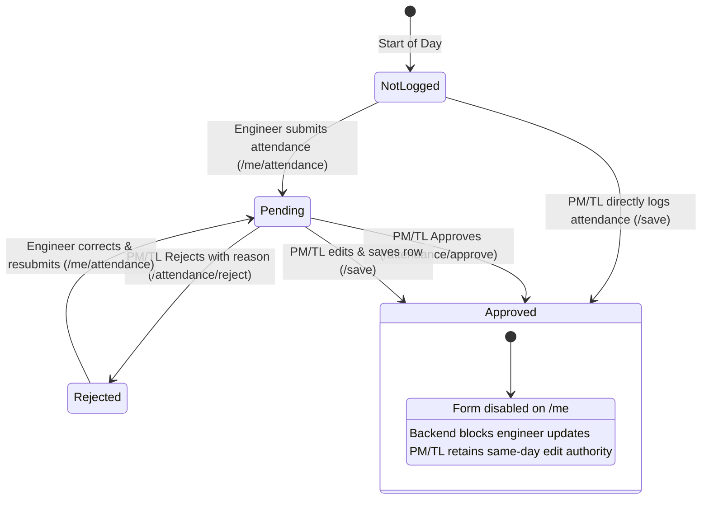

# Self-Service Daily Attendance & Same-Day PM/TL Approval Specification

**Document Version:** 1.0  
**Implementation Phase:** Task 1.0 & Task 1.1 (Priority 1)  
**Target Environment:** Local Docker Replica & Production Attendance Service  
**Date:** October 21, 2026  

---

## 1. Executive Summary & Design Principles

To ensure accurate attendance tracking without creating administrative bottlenecks for Project Managers (PMs) and Team Leads (TLs), the attendance system implements a **Self-Service Daily Logging with Same-Day PM/TL Verification & Rejection Workflow**.

### Core Principles
1. **Unified Interface Consistency:** The Engineer self-entry form on `/me` mirrors the exact columns, input validation, and live calculation metrics (`In`, `Out`, `Hours`, `Late by`, `Short by`, `Duty Status`, `Leave Type`, `Planned?`, `Task Handled By`, and `Remarks`) used by PMs/TLs on the daily management grid.
2. **PM/TL Verification & Oversight:** Submissions made by engineers enter a `Pending` state. The PM/TL reviews entries on their daily project grid and can approve entries individually, bulk-approve all submissions in 1 click, or edit entries inline.
3. **Actionable Rejections:** PMs/TLs can reject inaccurate submissions (e.g. punch time discrepancies or incorrect leave types) with a mandatory remark/reason. The engineer is notified via a prominent alert on `/me` and the form is immediately unlocked for correction and resubmission.
4. **Strict Post-Approval Locking:** Once attendance is approved (or directly entered by the PM/TL), it is strictly locked for the engineer. The UI disables all inputs with a lock icon, and the backend rejects any unauthorized `POST` attempts.

---

## 2. State Machine & Workflow Architecture



### State Descriptions
| Status | Label in UI | Description | Engineer Form (`/me`) | PM/TL Actions (`/`) |
| :--- | :--- | :--- | :--- | :--- |
| **Not Logged** | `Not Logged Yet` | No punch or leave record exists for today. | Fully editable | Can manually enter & save |
| **Pending** | `Submitted · Pending PM/TL Approval` | Engineer submitted attendance for today. | Editable (allows adjustment before approval) | `✓ Approve`, `✕ Reject`, or inline edit |
| **Rejected** | `Submission Rejected by PM/TL` | PM/TL rejected entry with a remark. | **Unlocked for correction** with red alert banner | Can approve or re-edit |
| **Approved** | `✓ Verified / Approved by PM/TL` | PM/TL verified and approved the submission. | **🔒 Strictly Locked** (read-only) | Retains same-day edit permissions |

---

## 3. Database Schema & Migration Changes

The `attendance` table in PostgreSQL / SQLite incorporates dedicated audit and approval tracking columns:

```sql
-- Migration applied automatically in app.py (init_db)
ALTER TABLE attendance ADD COLUMN IF NOT EXISTS duty_status TEXT DEFAULT 'Present';
ALTER TABLE attendance ADD COLUMN IF NOT EXISTS approval_status TEXT DEFAULT 'Approved';
ALTER TABLE attendance ADD COLUMN IF NOT EXISTS submitted_by TEXT DEFAULT '';
ALTER TABLE attendance ADD COLUMN IF NOT EXISTS approved_by TEXT DEFAULT '';
ALTER TABLE attendance ADD COLUMN IF NOT EXISTS approved_at TEXT DEFAULT '';
ALTER TABLE attendance ADD COLUMN IF NOT EXISTS rejection_reason TEXT DEFAULT '';
```

### Field Definitions
* `duty_status`: Tracks full day vs half day (`Present` | `Half Day`).
* `approval_status`: Workflow state (`Pending` | `Approved` | `Rejected`). Default for PM direct entries is `Approved`.
* `submitted_by`: Email address of the user who logged the initial record.
* `approved_by`: Email address of the PM/TL/Admin who approved or rejected the entry.
* `approved_at`: ISO 8601 timestamp (`YYYY-MM-DDTHH:MM:SS`) of when the approval/rejection decision occurred.
* `rejection_reason`: Explanation note provided by PM/TL when rejecting an entry (up to 300 characters).

---

## 4. User Journeys & UI Specifications

### 4.1 Engineer Daily Attendance Logging (`/me`)

1. **Dashboard Access:** When an engineer navigates to `/me`, the top card displays **"Enter Today's Attendance"** with today's date and active project name.
2. **Input Fields:**
   * **Duty Status:** Dropdown (`Present` | `Half Day`).
   * **In & Out Times:** Standard `HH:MM` time pickers with automatic recalculation of Worked Hours, Late by, and Short by.
   * **Leave Logging:** If taking leave, dropdown selection for `CL`, `PL`, `SL`, `Comp Off`, `Short Leave`, or `LWP`.
   * **Planned / Unplanned:** Radio/checkbox toggle.
   * **Task Handled By:** Dropdown populated with active project teammates (excluding teammates already on leave today).
   * **Remarks:** Text input for notes (e.g. `Client site visit`, `WFH morning`).
3. **Submission:**
   * Clicking **"Save Today's Attendance"** submits to `POST /me/attendance`.
   * Row is stored with `approval_status = 'Pending'`.
   * A status badge turns Amber: `Submitted · Pending PM/TL Approval`.

---

### 4.2 PM/TL Verification & Approval Workflow (`/`)

1. **Pending Badges & Banner Notification:**
   * When pending submissions exist, project tabs show count badges (e.g., `Project Alpha (3)`).
   * Top banner alerts PM/TL:  
     `ℹ️ 3 attendance entries submitted by engineers are awaiting verification for today.`
   * A **`✓ Approve All Submitted (3)`** button allows 1-click bulk approval.
2. **Daily Grid Actions:**
   * The **Approval** column displays:
     * `✓ Approve` button: Submits `POST /attendance/approve` for the individual engineer.
     * `✕ Reject` button: Opens the Rejection Modal dialog.
   * PMs/TLs can adjust times or remarks inline before clicking approve.
3. **Bulk Approval:**
   * Submits `POST /attendance/approve` with `mode=all`.
   * Transitions all `Pending` rows for the selected project and date to `Approved`.

---

### 4.3 PM/TL Rejection & Engineer Correction Flow

1. **PM Rejection Trigger:**
   * PM clicks `✕ Reject` next to an engineer's row.
   * Modal dialog `#rejectModal` prompts: *"Enter reason for rejection (required)"*.
   * Example remark: *"In-time mismatch: Biometric record shows 09:45 AM arrival"*.
2. **Backend Processing (`POST /attendance/reject`):**
   * Sets `approval_status = 'Rejected'`.
   * Stores `rejection_reason = '...'`, `approved_by = pm_email`, `approved_at = timestamp`.
3. **Engineer Alert on `/me`:**
   * Prominent Red Alert Banner appears:
     > **⚠️ Attendance Submission Rejected by PM/TL:** In-time mismatch: Biometric record shows 09:45 AM arrival  
     > *Review and update your In/Out times or remarks below, then click "Resubmit Attendance".*
   * Form inputs are unlocked and pre-filled with previous values.
   * Button label updates to **"Resubmit Attendance"**.
4. **Resubmission (`POST /me/attendance`):**
   * Engineer corrects `In` time to `09:45` and clicks Resubmit.
   * Backend resets `approval_status = 'Pending'` and clears `rejection_reason = ''`.

---

### 4.4 Strict Post-Approval Locking

1. **UI Locking (`GET /me`):**
   * Once approved, `today_locked_reason` triggers:
     `🔒 Today's attendance has been verified and approved by your PM/TL. Contact your PM/TL if any modification is needed.`
   * All form controls (`<input>`, `<select>`) receive the `disabled` attribute.
   * Submit button is hidden.
   * Top badge displays green: `✓ Verified / Approved by PM/TL`.
2. **Backend Enforcement (`POST /me/attendance`):**
   * If an engineer bypasses UI or sends a direct `POST` request when `approval_status == 'Approved'`, the backend rejects the request:
     ```python
     if ex and ex.get("approval_status") == "Approved" and (ex.get("in_time") or ex.get("leave_type") or ex.get("remarks")):
         flash("Today's attendance has already been approved by your PM/TL and is locked.", "err")
         return redirect(url_for("me"))
     ```

---

## 5. API Endpoints & Request Contracts

### 5.1 Engineer Self-Submission (`POST /me/attendance`)
* **Access:** Any signed-in team member with an active project assignment.
* **Payload:**
  ```http
  POST /me/attendance HTTP/1.1
  Content-Type: application/x-www-form-urlencoded

  csrf=<csrf_token>&
  day=2026-10-21&
  duty_status=Present&
  in_time=09:30&
  out_time=18:30&
  leave_type=&
  planned=0&
  handled_by=&
  remarks=On-time+arrival
  ```
* **Response:** Redirects to `/me` with flash message.

### 5.2 PM/TL Approval (`POST /attendance/approve`)
* **Access:** Project PM, TL, or Administrator.
* **Payload:**
  ```http
  POST /attendance/approve HTTP/1.1
  Content-Type: application/x-www-form-urlencoded

  csrf=<csrf_token>&
  date=2026-10-21&
  project=10&
  user_id=101&
  mode=single
  ```
* **Bulk Payload:** `mode=all` (approves all pending rows in `project` for `date`).

### 5.3 PM/TL Rejection (`POST /attendance/reject`)
* **Access:** Project PM, TL, or Administrator.
* **Payload:**
  ```http
  POST /attendance/reject HTTP/1.1
  Content-Type: application/x-www-form-urlencoded

  csrf=<csrf_token>&
  date=2026-10-21&
  project=10&
  user_id=101&
  reason=Punch+time+does+not+match+biometric+logs
  ```

---

## 6. End-to-End Verification & Automated Test Results

The entire workflow has been verified via automated test execution against the local PostgreSQL Docker container (`docker exec attendance python3 ...`).

### Test Coverage Matrix
| Step | Action | Expected Outcome | Verification Status |
| :--- | :--- | :--- | :--- |
| **1** | Engineer logs punch on `/me/attendance` | DB row saved with `approval_status='Pending'`, `submitted_by` recorded | **PASS** (100%) |
| **2** | PM rejects entry via `/attendance/reject` with reason | Status becomes `Rejected`, `rejection_reason` stored, `approved_by` recorded | **PASS** (100%) |
| **3** | Engineer views `/me` and resubmits corrected time | Red rejection banner rendered, form unlocked, resubmission resets status to `Pending` | **PASS** (100%) |
| **4** | PM approves entry via `/attendance/approve` | Status becomes `Approved`, `approved_by` and `approved_at` recorded | **PASS** (100%) |
| **5** | Engineer attempts modification after approval | UI inputs disabled, backend blocks unauthorized `POST /me/attendance` | **PASS** (100%) |

---

## 7. Next Priority Implementation (Task 2.0)

With Task 1.0 (Self-Service Attendance) and Task 1.1 (Same-Day Approval/Rejection/Locking) verified and documented, the next atomic phase is:
* **Task 2.0: Employee Leave Application & Cancellation Workflow (`/me/leave/apply`, multi-day leave requests, team calendar conflict check).**
