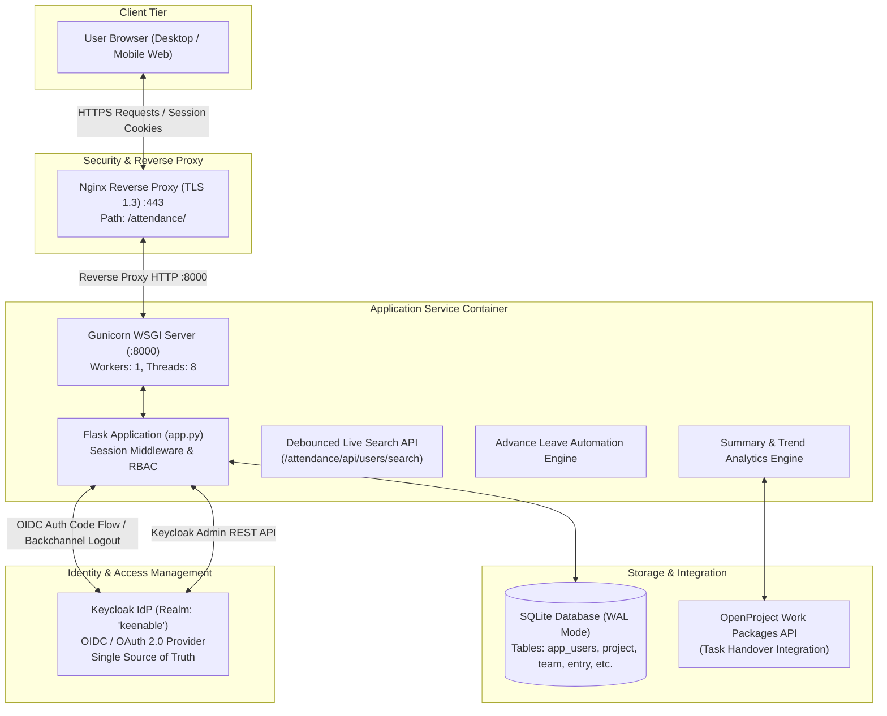
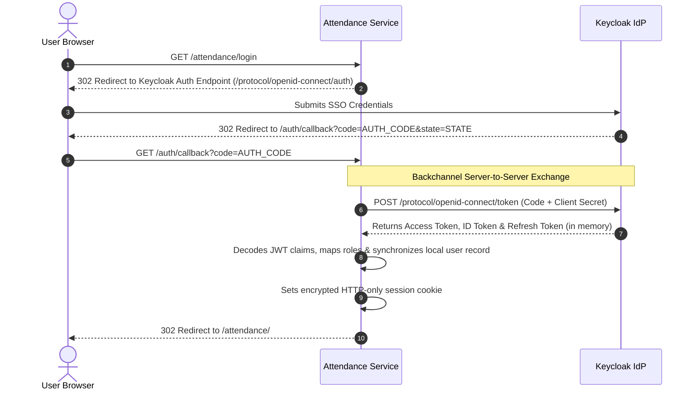
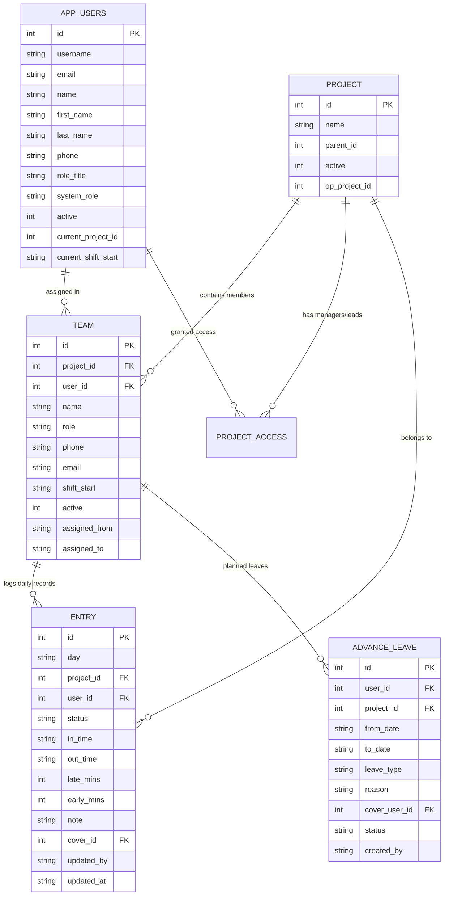
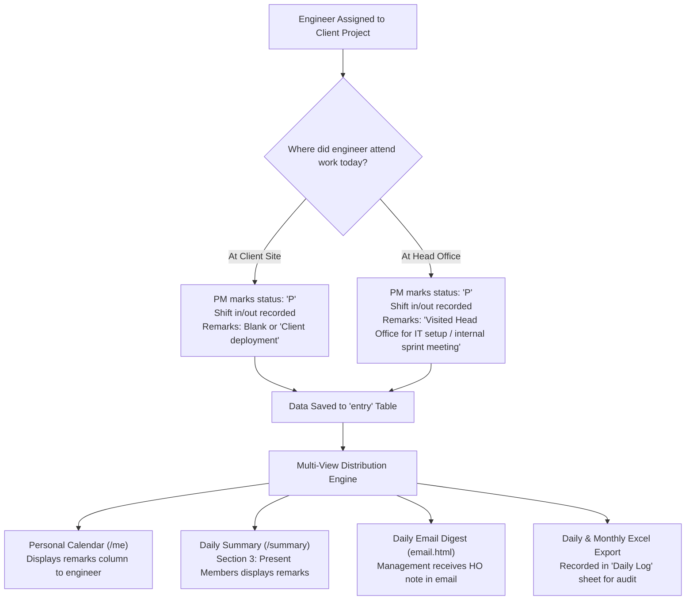

# Enterprise Attendance & Shift Management Portal
## Comprehensive Technical Documentation & Architecture Specification

| Document Metadata | Specification |
| :--- | :--- |
| **System Module** | Attendance Service (`attendance-service`) |
| **Document Version** | 3.0 (Production Release) |
| **Runtime Environment** | Python 3.12, Gunicorn WSGI, SQLite (WAL Mode), Linux Container (Podman/Docker) |
| **Authentication Standard** | OpenID Connect (OIDC) / OAuth 2.0 via Keycloak 24+ |
| **Reverse Proxy** | Nginx with TLS 1.3 Termination |
| **Primary Production Host** | `159.65.155.30` (Systemd Service: `attendance.service`) |

---

## 1. System Overview & Architectural Philosophy

### 1.1 Purpose and Scope
The **Enterprise Attendance & Shift Management Portal** is a high-performance, real-time web application engineered to track project-level engineering attendance, shift punctuality, operational remarks (including Head Office visits vs. Client Site deployments), and advance pre-approved leaves across multi-project organizations.

### 1.2 Core Architectural Principles
1. **Single Source of Truth (SSoT) for Identity**:
   * All user authentication, credential storage, password lifecycles, and core profile attributes (`username`, `email`, `phone`, `system_role`) are strictly governed by **Keycloak Enterprise SSO**.
   * The Attendance module maintains operational and transactional data (project assignments, shift schedules, daily check-ins, advance leave logs) linked directly to the Keycloak user identity.
2. **Confidential Client Security Architecture**:
   * OIDC Authorization Code Flow operates strictly backend-to-backend. Tokens (Access Token, Refresh Token, ID Token) are kept in backend memory and are never exposed to browser-side JavaScript, eliminating client-side token interception risks.
3. **High Performance & Zero-Bloat Frontend**:
   * The application uses server-rendered Jinja2 templates styled with a native CSS custom property system (`--nav`, `--line`, `--bg`, `--card`, `--ink`).
   * Minimalist Vanilla ES6 JavaScript is utilized exclusively for interactive modals, debounced live directory searching, and tooltip positioning.
4. **Resilient Transactional Storage**:
   * Relational data storage utilizing SQLite in **Write-Ahead Logging (WAL)** mode, providing atomic transactions, high concurrency, and zero lock contention between reads and writes.

---

### 1.3 High-Level System Architecture Diagram



---

## 2. Technology Stack & Infrastructure

| Layer | Component | Version / Technology | Function / Architecture |
| :--- | :--- | :--- | :--- |
| **Backend Framework** | Flask | 3.0+ | Lightweight, thread-safe Python micro-framework. |
| **WSGI Server** | Gunicorn | 22.0+ | Multithreaded production application server (`--threads 8`). |
| **Language Runtime** | Python | 3.12 | Strongly typed, high-performance runtime. |
| **Database** | SQLite (Production) | 3.45+ | Configured with `PRAGMA journal_mode=WAL;` and foreign key enforcement. |
| **Identity Provider** | Keycloak | 24+ | Enterprise OpenID Connect 1.0 Provider. |
| **Reporting / Export** | `openpyxl` | 3.1+ | Server-side Excel generation for daily and monthly rollups. |
| **Container Engine** | Podman / Docker | 4.9+ / 25+ | Rootless container execution via Systemd unit (`attendance.container`). |
| **Web Server / Proxy** | Nginx | 1.24+ | SSL/TLS termination, HTTP/2 gateway, security headers. |

---

## 3. Authentication & Keycloak Integration (OIDC)

### 3.1 Authorization Code Grant Flow (Confidential Client)
The portal implements the OAuth 2.0 / OpenID Connect Authorization Code Flow using `authlib`:



### 3.2 Keycloak User Profile Synchronization
During `/auth/callback`, the Flask backend extracts identity claims from the ID/Access token and synchronizes with `app_users`:
* **Claims Mapped**: `email`, `preferred_username`, `given_name`, `family_name`, `phone_number` / `phone`.
* **System Role Resolution**:
  ```python
  is_admin_user = user_email in ADMIN_EMAILS or KC_ADMIN_ROLE in roles
  is_pm_user = KC_MANAGER_ROLE in roles
  role_title = "Admin" if is_admin_user else ("Project Manager" if is_pm_user else "Engineer")
  sys_role = "admin" if is_admin_user else ("project-manager" if is_pm_user else "member")
  ```

### 3.3 Single Log-Out (SLO) Architecture
The system supports both Frontchannel and Backchannel Single Log-Out:
1. **Backchannel Logout Endpoint (`/backchannel_logout`)**:
   * Keycloak sends a signed `logout_token` JWT via backchannel POST.
   * Backend verifies the token signature, extracts the user subject (`sub`) and session ID (`sid`), and stores them in `backchannel_logout_tokens`.
2. **Session Invalidation Interceptor (`@app.before_request`)**:
   * Every incoming request verifies if `session['kc_sub']` or `session['kc_sid']` exists in `backchannel_logout_tokens`.
   * If revoked, the local session is cleared immediately, redirecting the user to `/login`.

---

## 4. Role-Based Access Control (RBAC) & Permission Matrix

The application strictly separates permissions across three distinct operational roles:

| Action / Feature Area | Software Engineer (`member`) | Project Manager / Tech Lead (`lead`/`pm`) | System Administrator (`admin`) |
| :--- | :---: | :---: | :---: |
| **Personal Attendance View (`/me`)** | Read-Only | Read-Only | Read-Only |
| **Daily Attendance Marking (`/`)** | Denied | **Allowed** (Assigned Projects Only) | **Allowed** (All Projects) |
| **Past Date Attendance Editing** | Denied | **Denied** (Locked: `day < today`) | **Allowed** (Unrestricted Override) |
| **Advance Leave Pre-Marking** | Denied | **Allowed** (Current & Future Dates) | **Allowed** (All Dates) |
| **Remarks / Notes Logging (HO / Client)** | Denied | **Allowed** | **Allowed** |
| **Team Roster Management (`/team`)** | Denied | View Only | **Allowed** (Bench / Reallocate) |
| **Cross-Project Team Transfers** | Denied | Denied | **Allowed** (1-Click Instant Transfer) |
| **Project Configuration (`/projects`)** | Denied | Denied | **Allowed** |
| **Summary & Reports (`/summary`)** | Self Only | Assigned Projects | Organization-Wide |
| **Visual Trends & Scorecards (`/trends`)** | Self Only | Assigned Projects | Organization-Wide |
| **Daily & Monthly Excel Exports** | Denied | Assigned Projects | Organization-Wide |
| **Instant Email Summary Trigger** | Denied | Denied | **Allowed** |

### Past-Date Enforcement Guard (`can_edit_attendance`)
```python
def can_edit_attendance(pid, day_str):
    if is_admin():
        return True
    if not can_edit(pid):
        return False
    # Non-admins cannot modify past attendance records
    return day_str >= today()
```

---

## 5. Database Schema & Data Models



### Table Definitions

#### 1. `app_users`
Authoritative local mirror of Keycloak user records.
```sql
CREATE TABLE app_users (
    id INTEGER PRIMARY KEY AUTOINCREMENT,
    username TEXT UNIQUE NOT NULL,
    email TEXT UNIQUE NOT NULL,
    name TEXT NOT NULL,
    first_name TEXT,
    last_name TEXT,
    phone TEXT,
    role_title TEXT DEFAULT 'Engineer',
    system_role TEXT DEFAULT 'member', -- 'admin', 'project-manager', 'member'
    active INTEGER DEFAULT 1,
    current_project_id INTEGER,
    current_shift_start TEXT DEFAULT '09:30',
    password_hash TEXT DEFAULT 'OIDC_MANAGED',
    created_at TIMESTAMP DEFAULT CURRENT_TIMESTAMP,
    updated_at TIMESTAMP DEFAULT CURRENT_TIMESTAMP
);
CREATE INDEX idx_app_users_email ON app_users(lower(email));
```

#### 2. `team`
Maintains project rosters, assigned shift schedules, and historical project associations.
```sql
CREATE TABLE team (
    id INTEGER PRIMARY KEY AUTOINCREMENT,
    project_id INTEGER NOT NULL,
    user_id INTEGER,
    name TEXT NOT NULL,
    role TEXT DEFAULT 'Engineer',
    phone TEXT,
    email TEXT NOT NULL,
    shift_start TEXT DEFAULT '09:30',
    active INTEGER DEFAULT 1,
    assigned_from TEXT,
    assigned_to TEXT,
    FOREIGN KEY(project_id) REFERENCES project(id),
    FOREIGN KEY(user_id) REFERENCES app_users(id)
);
CREATE INDEX idx_team_proj_active ON team(project_id, active);
CREATE INDEX idx_team_email ON team(lower(email));
```

#### 3. `entry` (Attendance Records)
Stores daily transactional attendance entries.
```sql
CREATE TABLE entry (
    id INTEGER PRIMARY KEY AUTOINCREMENT,
    day TEXT NOT NULL,              -- YYYY-MM-DD
    project_id INTEGER NOT NULL,
    user_id INTEGER NOT NULL,
    status TEXT NOT NULL,           -- 'P', 'A', 'L', 'HD', 'W', 'H', 'CO'
    in_time TEXT,                   -- HH:MM
    out_time TEXT,                  -- HH:MM
    late_mins INTEGER DEFAULT 0,
    early_mins INTEGER DEFAULT 0,
    note TEXT,                      -- Operational remarks (HO visit, client site, medical, etc.)
    cover_id INTEGER,               -- Handover cover engineer user ID
    updated_by TEXT,
    updated_at TIMESTAMP DEFAULT CURRENT_TIMESTAMP,
    UNIQUE(day, project_id, user_id)
);
CREATE INDEX idx_entry_day_proj ON entry(day, project_id);
```

#### 4. `advance_leave`
Stores grouped multi-day advance leave spans entered by PM/TL/Admin.
```sql
CREATE TABLE advance_leave (
    id INTEGER PRIMARY KEY AUTOINCREMENT,
    user_id INTEGER NOT NULL,
    project_id INTEGER NOT NULL,
    from_date TEXT NOT NULL,
    to_date TEXT NOT NULL,
    leave_type TEXT NOT NULL,       -- 'Casual', 'Sick', 'Earned', 'Comp-Off', 'Optional'
    reason TEXT,
    cover_user_id INTEGER,
    status TEXT DEFAULT 'APPROVED', -- Direct advance logging
    created_by TEXT,
    created_at TIMESTAMP DEFAULT CURRENT_TIMESTAMP
);
```

---

## 6. Core Business Logic & Algorithms

### 6.1 Status Codes & Operational Semantics
| Code | Label | Database Representation | Semantics |
| :---: | :--- | :---: | :--- |
| **`P`** | Present | `P` | Engineer actively on duty during scheduled shift hours. |
| **`A`** | Absent | `A` | Unplanned absence without prior email notice or approval. |
| **`L`** | Leave | `L` | Approved full-day planned leave pre-approved on email. |
| **`HD`** | Half Day | `HD` | Worked half shift (first or second half) with PM approval. |
| **`W`** | Work From Home | `W` | Remote duty offsite approved by PM. |
| **`H`** | Holiday | `H` | Public holiday, company festival, or official day off. |
| **`CO`** | Comp-Off | `CO` | Compensatory leave credited for weekend/holiday duty. |

---

### 6.2 Operational Remarks Workflow: Client Site vs. Head Office Duty
A critical operational capability of the Attendance portal is tracking engineer movement between **Client Sites** and the **Head Office (HO)** without breaking project billing or attendance integrity.



#### Implementation Details
* When an engineer attends Head Office, their project status is preserved (`P`).
* The operational reason is entered into the `remarks` text input field in the daily entry table.
* The backend saves this string directly into `entry.note`.
* The reporting engine surfaces `entry.note` in all summary tables, daily email alerts, and exported Excel workbooks (`attendance_<month>.xlsx`), ensuring clear justification during client billing reconciliations.

---

### 6.3 Advance Leave Automation Algorithm
The Leave Management modal eliminates manual date-by-date calendar entry by automating future attendance records:

```python
def apply_advance_leave(user_id, project_id, from_date_str, to_date_str, leave_type, reason, cover_id, admin_user):
    cur_d = date.fromisoformat(from_date_str)
    end_d = date.fromisoformat(to_date_str)
    
    # 1. Insert grouped metadata into advance_leave
    db.execute("""
        INSERT INTO advance_leave (user_id, project_id, from_date, to_date, leave_type, reason, cover_user_id, created_by)
        VALUES (?, ?, ?, ?, ?, ?, ?, ?)
    """, (user_id, project_id, from_date_str, to_date_str, leave_type, reason, cover_id, admin_user))
    
    # 2. Batch-populate future daily attendance entries (skipping weekends)
    while cur_d <= end_d:
        weekday = cur_d.strftime("%a")
        if weekday not in ("Sat", "Sun"): # Weekend Skipping
            day_str = cur_d.isoformat()
            db.execute("""
                INSERT INTO entry (day, project_id, user_id, status, note, cover_id, updated_by)
                VALUES (?, ?, ?, 'L', ?, ?, ?)
                ON CONFLICT(day, project_id, user_id) DO UPDATE SET
                    status = 'L',
                    note = excluded.note,
                    cover_id = excluded.cover_id,
                    updated_by = excluded.updated_by
            """, (day_str, project_id, user_id, f"Advance Leave: {leave_type} - {reason}", cover_id, admin_user))
        cur_d += timedelta(days=1)
    db.commit()
```

#### Early Return Clearance Logic
If an engineer returns early (e.g., reporting to duty on Thursday when on leave through Friday):
* The PM/TL simply selects **Present (`P`)** on today's row on the Enter Attendance page (`/`) and saves.
* The system updates today's record to `P` with logged check-in hours, while leaving Friday's `L` record completely intact.

---

### 6.4 Reporting & Analytics Engines (`/summary` and `/trends`)

#### 1. Daily Summary KPI Aggregator (`/summary`)
* Computes real-time counts across the active roster:
  $$\text{Total} = \text{Present} + \text{Absent} + \text{On Leave} + \text{Unentered}$$
* Categorizes members into actionable sections:
  * **Section 1: Absent (No info)**: Identifies unnotified absences.
  * **Section 2: Not Entered Yet**: Pinpoints PMs who have not completed daily entry.
  * **Section 3: On Leave & Task Handover**: Integrates with OpenProject to list open work packages assigned to the absent engineer, confirming cover coverage.
  * **Section 4: Present Members**: Full roster with shift start, in/out timestamps, hours in office, late arrival pill, and **Remarks**.
  * **Section 5: Late Arrivals**: Sorted by lateness duration.
  * **Section 6: Shift Shortage**: Members who completed fewer than required shift hours.

#### 2. Trends & Irregularity Scoring Algorithm (`/trends`)
Evaluates attendance consistency across 7, 14, 30, 60, or 90 days.
* **Irregularity Scoring Formula**:
  $$\text{Score} = \text{Late Days} + \text{Short Days} + 2 \times \text{Unplanned Leaves} + 3 \times \text{Absences}$$
* **Irregular Flag Criteria**:
  $$\text{is\_irregular} = (\text{Late} \ge 2 \land \text{Late \%} \ge 30\%) \lor (\text{Absences} \ge 2) \lor (\text{Unplanned Leaves} \ge 2) \lor (\text{Short Days} \ge 3)$$
* **Direction Trend Calculation**:
  Compares lateness ratio in the first half ($H_1$) vs. second half ($H_2$) of the selected period:
  $$\Delta = \text{Ratio}(H_2) - \text{Ratio}(H_1)$$
  $$\text{Direction} = \begin{cases} \text{"Getting worse"} & \text{if } \Delta \ge 0.20 \\ \text{"Improving"} & \text{if } \Delta \le -0.20 \\ \text{"Steady"} & \text{otherwise} \end{cases}$$

---

### 6.5 Live Debounced Search & Admin Cross-Project Transfers

#### Client-Side Search Engine (`team.html`)
To prevent server flooding, live directory search implements a 250ms debouncer:
```javascript
var searchDebounceTimer = null;
function handleInputDebounced() {
  clearTimeout(searchDebounceTimer);
  var q = (searchInput.value || '').trim();
  if (!q) {
    document.getElementById('modal_results_area').innerHTML = '';
    return;
  }
  searchDebounceTimer = setTimeout(function() {
    executeUserSearch();
  }, 250);
}
```

#### Admin Transfer Transaction (`team_add`)
When an Admin transfers an engineer from Project A to Project B:
1. Deactivates engineer in Project A's roster (`team.active = 0`, `assigned_to = today()`).
2. Inserts or updates engineer record in Project B (`team.active = 1`, `assigned_from = today()`, `shift_start = new_shift`).
3. Updates `app_users.current_project_id = target_project_id`.
4. Preserves all historical attendance records in Project A untouched.

---

## 7. API Endpoints Reference

### Web Application Routes
| Method | Path | Access Level | Description |
| :--- | :--- | :---: | :--- |
| `GET` | `/` or `/entry` | Authenticated | Main daily attendance entry grid. |
| `POST` | `/entry/save` | PM / Lead / Admin | Persists daily attendance rows. |
| `GET` | `/me` | All Users | Self-service attendance calendar & history. |
| `GET` | `/summary` | Authenticated | Daily & monthly summary KPI dashboard. |
| `GET` | `/trends` | Authenticated | Long-term visual trend charts & irregularity scorecards. |
| `GET` | `/team` | Authenticated | Project roster management & transfer modal. |
| `POST` | `/team/add` | Admin / PM | Adds member, updates shift, or transfers between projects. |
| `POST` | `/team/remove` | Admin / PM | Releases engineer to Bench Pool. |
| `POST` | `/leave/apply_advance` | PM / Lead / Admin | Submits pre-approved multi-day advance leave. |
| `POST` | `/leave/cancel` | PM / Lead / Admin | Cancels scheduled advance leave span. |
| `GET` | `/export/daily.xlsx` | PM / Admin | Downloads daily attendance report in Excel format. |
| `GET` | `/export/monthly.xlsx` | PM / Admin | Downloads comprehensive monthly attendance workbook. |

### Internal REST Endpoints
#### `GET /attendance/api/users/search`
* **Query Parameters**:
  * `project`: Active Project ID.
  * `q`: Substring search query (searches name and email).
* **Response Format**:
  ```json
  [
    {
      "id": 14,
      "name": "Mohd Imran",
      "email": "imran.mohd@fosteringlinux.com",
      "phone": "+91 9876543210",
      "role": "Software Engineer",
      "current_project_id": 2,
      "current_project_name": "Civil Services Portal",
      "current_shift_start": "09:30"
    }
  ]
  ```

---

## 8. Deployment, System Operations & Security

### 8.1 Production Environment Configuration (`attendance.env`)
```ini
BASE_URL=https://pm.keenable.io/attendance
SECRET_KEY=production_encrypted_secret_key
DATABASE_PATH=/opt/attendance-service/data/attendance.db

# Keycloak OIDC Confidential Client
OIDC_CLIENT_ID=attendance-service
OIDC_CLIENT_SECRET=production_kc_client_secret
OIDC_DISCOVERY_URL=https://pm.keenable.io/auth/realms/keenable/.well-known/openid-configuration

# Shift Rules
SHIFT_START=09:30
GRACE_MIN=15
SHIFT_MIN=510

# Admin Identifiers
ADMIN_EMAILS=arunk.pal@fosteringlinux.com,admin@fosteringlinux.com
KC_ADMIN_ROLE=attendance-admin
KC_MANAGER_ROLE=project-manager
```

### 8.2 Systemd Container Execution (`attendance.service`)
```bash
# Check service status
systemctl status attendance

# Restart service after deployment
systemctl restart attendance

# Stream production container logs
podman logs -f attendance
```

### 8.3 Security Best Practices
1. **CSRF Protection**: All POST forms include a cryptographically random `csrf_token` checked prior to execution.
2. **Strict Session Cookies**: Configured with `HttpOnly=True`, `Secure=True`, and `SameSite=Lax`.
3. **Prepared SQL Statements**: All database operations use parameterized queries (`?`), preventing SQL injection.
4. **Data Isolation**: SQLite running in WAL mode with filesystem permissions restricted to rootless container user UID 1000.
