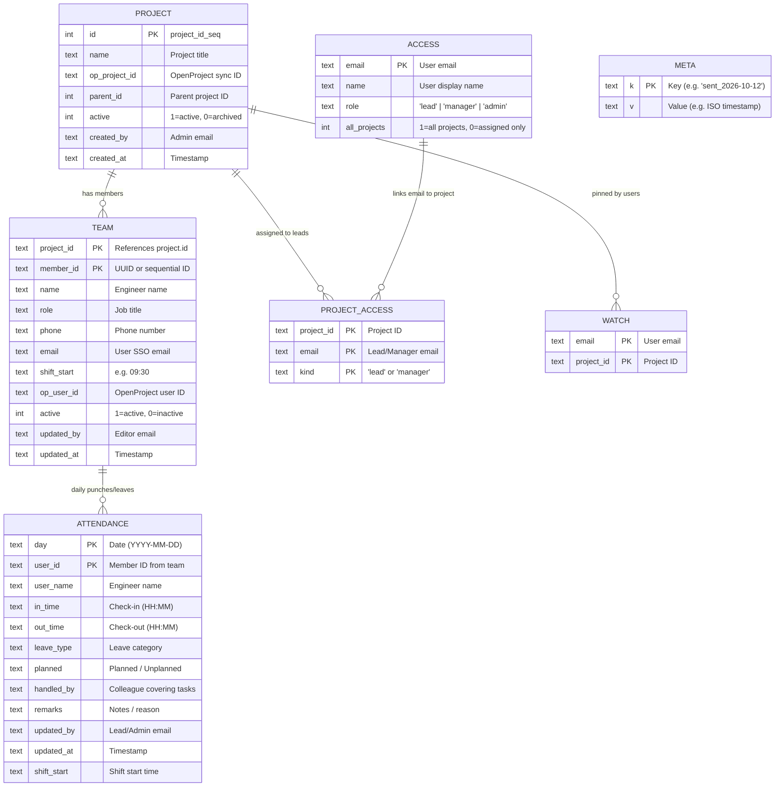
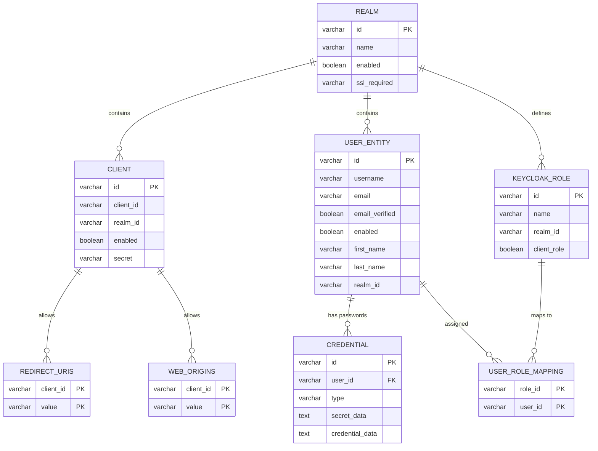

# Database Schema Reference: Attendance & Keycloak SSO

Both databases reside within the **PostgreSQL 17** container (`openproject-db`) on `pm.keenable.io`:
* **`attendance` Database**: Dedicated application database storing attendance logs, project teams, fine-grained access rules, watched projects, and scheduler state.
* **`keycloak` Database**: Keycloak 26 Identity Provider database handling user authentication, credentials, realms, and OIDC roles.

---

## 📊 1. Attendance Database Schema (`attendance`)

The `attendance` database contains **7 tables** and **1 sequence**. Every single table is actively utilized by the application:

| Relation Name | Type | Purpose in Application |
| :--- | :--- | :--- |
| **`attendance`** | Table | Daily punch logs (in/out), hours, leave records, and coverage |
| **`team`** | Table | Project member rosters, job titles, emails (for SSO), and custom shift start times |
| **`project`** | Table | Project directory, sub-project hierarchy, active/archived state |
| **`project_id_seq`** | Sequence | Auto-increment sequence generator for `project.id` (`1, 2, 3...`) |
| **`access`** | Table | User permission tier (`lead`, `manager`, `admin`) and global scope flag |
| **`project_access`** | Table | Maps specific Project Leads (`kind='lead'`) to projects they manage |
| **`watch`** | Table | User-specific project filter (allows PMs/Admins to pin/watch active projects) |
| **`meta`** | Table | Key-value store preventing duplicate automated daily summary email dispatches |

---

### Entity-Relationship Diagram



---

### Detailed Table-by-Table Breakdown

---

### 1. `attendance`
Stores the daily attendance punch logs and leave records for each employee.

* **Primary Key**: `(day, user_id)`
* **Indexes**: 
  * `attendance_pkey` on `(day, user_id)`
  * `attendance_user` on `(user_id, day)` (Optimizes monthly personal views `/me` and `/history`)
* **When queried/updated**:
  * Every time a lead visits `/entry` or `/` (reads records for the given date).
  * When submitting `/save` (inserts or updates daily in/out times or leaves).
  * In `/summary`, `/trends`, `/history`, and `/me`.

| Column | Type | Nullable | Description | Example Live Value |
| :--- | :--- | :--- | :--- | :--- |
| **`day`** | `text` | NOT NULL | ISO date string (`YYYY-MM-DD`) | `2026-10-12` |
| **`user_id`** | `text` | NOT NULL | Member identifier matching `team.member_id` | `201` |
| **`user_name`** | `text` | NOT NULL | Display name at the time of entry | `Arun Kumar` |
| **`in_time`** | `text` | NULL | 24h arrival time (`HH:MM`) | `09:15` |
| **`out_time`** | `text` | NULL | 24h departure time (`HH:MM`) | `18:30` |
| **`leave_type`** | `text` | NULL | Type of leave (`Casual Leave`, `Sick Leave`, etc.) | `Casual Leave` |
| **`planned`** | `text` | NULL | Whether leave was pre-approved: `Planned` or `Unplanned` | `Planned` |
| **`handled_by`** | `text` | NULL | Name of colleague covering tasks during absence | `Vikram Singh` |
| **`remarks`** | `text` | NULL | Notes entered by lead or admin | `Frontend sprint tasks` |
| **`updated_by`** | `text` | NULL | Email of the lead/admin who last saved the entry | `admin@keenable.io` |
| **`updated_at`** | `text` | NULL | ISO timestamp of modification | `2026-10-12T12:28:24+05:30` |
| **`shift_start`** | `text` | NULL | Shift start time applied to this record | `09:30` |

---

### 2. `team`
Defines the engineers assigned to each project, their job titles, contact details, and custom shift schedules.

* **Primary Key**: `(project_id, member_id)`
* **When queried/updated**:
  * On `/team` page (managed by Team Leads and Admins).
  * On `/entry` to build the list of members for the project tab.
  * During login to determine if an authenticated user is an Engineer (`my_member_ids()`).

| Column | Type | Default | Description | Example Live Value |
| :--- | :--- | :--- | :--- | :--- |
| **`project_id`** | `text` | NOT NULL | Project ID (links to `project.id`) | `1` |
| **`member_id`** | `text` | NOT NULL | Unique member ID (`m:...` or sequential) | `m:c6092597758d` |
| **`name`** | `text` | NOT NULL | Full name of the team member | `Mohd Sadik` |
| **`role`** | `text` | NULL | Job title / designation | `Developer` |
| **`phone`** | `text` | NULL | Contact phone number | `9090909090` |
| **`email`** | `text` | NULL | User email (matched with Keycloak token during SSO) | `dev.sadik@keenable.io` |
| **`shift_start`** | `text` | NULL | Custom shift start (if different from default `09:30`) | `10:00` |
| **`op_user_id`** | `text` | NULL | OpenProject user ID (used when OP sync is enabled) | `45` |
| **`active`** | `integer` | `1` | `1` = Active member, `0` = Removed/Archived | `1` |
| **`updated_by`** | `text` | NULL | Email of manager who added/updated this member | `admin@keenable.io` |
| **`updated_at`** | `text` | NULL | Timestamp of last change | `2026-10-12T12:17:54+05:30` |

---

### 3. `project`
The master list of projects and sub-projects.

* **Primary Key**: `(id)`
* **Sequence**: `project_id_seq`
* **When queried/updated**:
  * On `/projects` page to view and create projects.
  * In the top navigation bar to render the project tabs on the entry screen.

| Column | Type | Default | Description | Example Live Value |
| :--- | :--- | :--- | :--- | :--- |
| **`id`** | `integer` | `nextval('project_id_seq')` | Unique integer project ID | `1` |
| **`name`** | `text` | NOT NULL | Project name | `Cloud Migration & Infra` |
| **`op_project_id`**| `text` | NULL | OpenProject identifier (when integrated) | `cloud-infra` |
| **`parent_id`** | `integer` | NULL | Parent project ID (for hierarchical sub-projects) | `NULL` |
| **`active`** | `integer` | `1` | `1` = Active project, `0` = Archived project | `1` |
| **`created_by`** | `text` | NULL | Email of admin who created the project | `admin@keenable.io` |
| **`created_at`** | `text` | NULL | Creation timestamp | `2026-10-12 12:04:23` |

---

### 4. `project_id_seq` (PostgreSQL Sequence)
* **Type**: `sequence`
* **Attached to**: `project.id`
* **Purpose**: Generates monotonic, gapless integer IDs (`1, 2, 3...`) automatically whenever a new row is inserted into `project` without specifying an ID.
* **Current Value**: `3` (increment: `1`, min: `1`, max: `2147483647`).

---

### 5. `access`
Defines application-level access permissions. Used by the **Access Management** module (`/access`) accessible only to Admins.

* **Primary Key**: `(email)`
* **When queried/updated**:
  * On user sign-in: `access_row()` queries this table by user email to determine role (`lead`, `manager`, or `admin`).
  * In `my_projects()`: checks `all_projects` column. If `1`, manager sees every project in the system.
  * On `/access`: Admins can grant or revoke roles for any email.

| Column | Type | Default | Description | Example Live Value |
| :--- | :--- | :--- | :--- | :--- |
| **`email`** | `text` | NOT NULL | User email address | `pm.sharma@keenable.io` |
| **`name`** | `text` | NULL | Full name of the user | `Rahul Sharma` |
| **`role`** | `text` | NOT NULL | Role level: `'lead'` (TL/PM) or `'manager'` | `lead` |
| **`all_projects`** | `integer` | `0` | `1` = access to all projects; `0` = assigned projects only | `0` |

---

### 6. `project_access`
Stores the fine-grained relationship between a user and specific projects they lead.

* **Primary Key**: `(project_id, email, kind)`
* **When queried/updated**:
  * In `can_edit(pid)`: Checks if current user has `kind='lead'` on this project.
  * In `my_projects()`: Determines which project tabs appear for this Team Lead.
  * In `_set_leads(pid, emails)`: Automatically updated when assigning leads in `/projects` or `/access`.

| Column | Type | Nullable | Description | Example Live Value |
| :--- | :--- | :--- | :--- | :--- |
| **`project_id`** | `text` | NOT NULL | Target project ID | `1` |
| **`email`** | `text` | NOT NULL | Lead/PM user email | `pm.sharma@keenable.io` |
| **`kind`** | `text` | NOT NULL | Permission type (currently `'lead'`) | `lead` |

---

### 7. `watch`
Stores personal project preferences for Managers and Admins.

* **Primary Key**: `(email, project_id)`
* **Purpose**: If an organization has 50 projects, an admin or manager doesn't want all 50 tabs cluttering their screen every day. On the `/projects` page, users can check the "Watch" box for their priority projects.
* **When queried/updated**:
  * On `/projects/watch` (POST): saves or clears watched project IDs for the signed-in user.
  * In `shown_projects()`: if any projects are watched by this user, the dashboard only shows those watched projects instead of all 50.

| Column | Type | Nullable | Description | Example Live Value |
| :--- | :--- | :--- | :--- | :--- |
| **`email`** | `text` | NOT NULL | Email of the admin or manager | `admin@example.com` |
| **`project_id`** | `text` | NOT NULL | ID of the watched project | `1` |

---

### 8. `meta`
A key-value persistence store used by system background tasks and schedulers.

* **Primary Key**: `(k)`
* **Purpose**: Prevents duplicate execution of daily summary emails.
* **When queried/updated**:
  * In `app.py` `scheduler()` background thread: At `SUMMARY_TIME` (19:00 PM), the scheduler attempts an atomic insert:
    ```sql
    INSERT INTO meta(k, v) VALUES ('sent_2026-10-12', '2026-10-12T19:00:00') ON CONFLICT DO NOTHING;
    ```
    If `rowcount == 1`, the email is dispatched. If the application restarts or has multiple workers, subsequent executions will encounter a conflict and skip, ensuring users **never receive duplicate summary emails**.

| Column | Type | Nullable | Description | Example Key Pattern |
| :--- | :--- | :--- | :--- | :--- |
| **`k`** | `text` | NOT NULL | Setting or tracking key | `sent_2026-10-12` |
| **`v`** | `text` | NULL | Setting value or ISO execution timestamp | `2026-10-12T19:00:00+05:30` |

---

## 🔐 2. Keycloak SSO Database Schema (`keycloak`)

Keycloak 26 manages 101 relational tables. The diagram below highlights the **core authentication and authorization tables**:



---

### Core Keycloak Table Reference

1. **`realm`**: Isolates organizations (e.g. `keenable`, `master`).
2. **`client`**: Registered applications connecting via OIDC (e.g. `attendance`).
3. **`redirect_uris`**: Whitelist of allowed authentication callback URLs:
   * `https://pm.keenable.io/attendance/auth/callback`
   * `https://pm.keenable.io/attendance/*`
4. **`web_origins`**: Allowed CORS web origins (`https://pm.keenable.io`).
5. **`user_entity`**: Master user accounts containing `username`, `email`, `first_name`, and `last_name`.
6. **`credential`**: Password hashes with PBKDF2/SHA256 salt and iteration counts.
7. **`keycloak_role`**: Stores roles (`attendance-admin`, `attendance-manager`, `default-roles-keenable`).
8. **`user_role_mapping`**: Maps `user_id` to `role_id` to grant administrators or managers their respective permissions.

---

## 🔗 3. System Data Flow: Bridging Keycloak & Attendance

```
┌────────────────────────────────────────────────────────┐
│                   KEYCLOAK DATABASE                    │
│ user_entity:                                           │
│   email: "dev.arun@keenable.io"                        │
│ user_role_mapping:                                     │
│   roles: ["default-roles-keenable"]                    │
└──────────────────────────┬─────────────────────────────┘
                           │ 1. User signs in with SSO
                           │ 2. Keycloak issues JWT token containing email & roles
                           ▼
┌────────────────────────────────────────────────────────┐
│                  ATTENDANCE DATABASE                   │
│                                                        │
│ Step A: Check Keycloak Roles                           │
│   - Has "attendance-admin"?   ──► Full Admin Access    │
│   - Has "attendance-manager"? ──► Manager Access       │
│                                                        │
│ Step B: Check access Table                             │
│   - SELECT * FROM access WHERE email = ?               │
│   - If role='lead' ──► Lead access to assigned pids    │
│                                                        │
│ Step C: Check team Table                               │
│   - SELECT * FROM team WHERE email = ?                 │
│   - Found in Client Web Portal ──► Engineer View (/me) │
│                                                        │
│ Step D: Check watch Table (for Admins / PMs)           │
│   - SELECT project_id FROM watch WHERE email = ?       │
│   - Filters visible tabs to watched projects only      │
└────────────────────────────────────────────────────────┘
```
