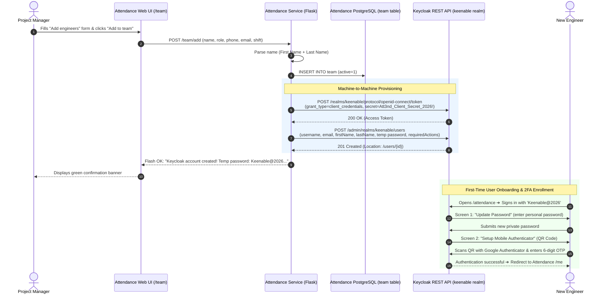

# Keycloak User Creation Flow & Implementation Reference

This document provides a comprehensive technical reference for the automated Keycloak user provisioning system integrated into the **Attendance Portal** (`pm.keenable.io/attendance`).

---

## 1. Executive Summary & Purpose

### The Problem
Previously, when a Project Manager or Admin added a new engineer on the **"My team"** tab (`/team/add`), the record was only stored in Attendance's local PostgreSQL database (`team` table). The engineer had no Keycloak account and could not log in to view their attendance until a system administrator manually provisioned them in Keycloak.

### The Solution
We implemented an **automated machine-to-machine (M2M) provisioning pipeline**:
1. When a team member is added with an email in Attendance, the backend immediately calls **Keycloak’s Admin REST API**.
2. A new Keycloak user is created in the `keenable` realm with:
   * Formatted **First Name** and **Last Name** (surname extracted automatically).
   * Initial temporary password (`Keenable@2026`).
   * Mandatory **Password Reset** on first login (`UPDATE_PASSWORD`).
   * Mandatory **Mobile OTP / 2FA setup** on first login (`CONFIGURE_TOTP`).
3. If the user already exists in Keycloak (e.g. they belong to another project), the app catches the `409 Conflict` and safely links them without failing.

---

## 2. Architecture & Communication Topology



---

## 3. Keycloak Service Account & Security Configuration

Keycloak prevents arbitrary callers from managing users. Rather than hardcoding master administrator credentials in the Attendance application, we utilized the **OAuth2 Client Credentials Grant via Service Account**:

### Step 1: Enable Service Account on the `attendance` Client
In Keycloak realm `keenable`, the existing OIDC client `attendance` was updated to enable Service Accounts:
```bash
podman exec keycloak /opt/keycloak/bin/kcadm.sh update clients/738018fe-7af3-4267-8175-e6987425688b \
  -r keenable \
  -s serviceAccountsEnabled=true
```

### Step 2: Grant User Management Roles
Keycloak automatically creates a special internal user representing the client: `service-account-attendance`.
We assigned it the **`manage-users`** client role from the built-in `realm-management` client:
```bash
SA_ID=$(podman exec keycloak /opt/keycloak/bin/kcadm.sh get clients/738018fe-7af3-4267-8175-e6987425688b/service-account-user -r keenable --fields id --format csv --noquotes)

podman exec keycloak /opt/keycloak/bin/kcadm.sh add-roles \
  -r keenable \
  --uid "$SA_ID" \
  --cclientid realm-management \
  --rolename manage-users
```

### Why this approach is optimal:
* **Zero Master Credentials**: The app never sees the Keycloak master password.
* **Least Privilege**: The service account is scoped only to user management within the `keenable` realm.
* **Reuses Existing Secret**: Utilizes `OIDC_CLIENT_SECRET=Att3nd_Client_Secret_2026!`, which was already configured in `/etc/attendance/attendance.env`.

---

## 4. Backend Implementation Details (`app.py`)

### 4.1. Name Parsing Algorithm
Attendance collects the full name in a single input (`Engineer name`), whereas Keycloak requires `firstName` and `lastName`.
To maintain corporate naming conventions (where the last word represents the surname / family name), we implemented:

```python
parts = (name or "").strip().split()
if not parts:
    first_name, last_name = "", ""
elif len(parts) == 1:
    first_name, last_name = parts[0], ""
else:
    first_name = " ".join(parts[:-1])   # All words except the last
    last_name = parts[-1]               # The final word (surname)
```

#### Mapping Examples:
| Input in Attendance | Keycloak `firstName` | Keycloak `lastName` | Formatted Display in Keycloak |
| :--- | :--- | :--- | :--- |
| `Mohd Sadik Khan` | `Mohd Sadik` | `Khan` | Mohd Sadik Khan |
| `Arun Kumar Singh` | `Arun Kumar` | `Singh` | Arun Kumar Singh |
| `Rahul Sharma` | `Rahul` | `Sharma` | Rahul Sharma |
| `Vikram` | `Vikram` | `""` | Vikram |

---

### 4.2. Keycloak REST API Integration Function (`keycloak_create_user`)
Located in [app.py](file:///opt/attendance-service/app.py):

```python
def keycloak_create_user(email, name):
    """Provisions a new user in Keycloak with a temporary password and forced reset on first login."""
    if not email or DEV:
        return ("skipped", None)
    issuer = E("OIDC_ISSUER", "").rstrip("/")
    if not issuer or "/realms/" not in issuer:
        return ("skipped", None)
    realm = issuer.split("/realms/")[1].split("/")[0]
    kc_base = E("KEYCLOAK_INTERNAL_URL", "http://keycloak:8080/auth").rstrip("/")
    client_id = E("OIDC_CLIENT_ID", "attendance")
    client_secret = E("OIDC_CLIENT_SECRET", "")
    try:
        # 1. Obtain service account token via client_credentials
        tok_res = requests.post(
            f"{kc_base}/realms/{realm}/protocol/openid-connect/token",
            data={
                "grant_type": "client_credentials",
                "client_id": client_id,
                "client_secret": client_secret,
            },
            timeout=10,
        )
        if tok_res.status_code != 200:
            app.logger.error("Keycloak token failed (%s): %s", tok_res.status_code, tok_res.text)
            return ("error", f"Keycloak authentication failed ({tok_res.status_code})")
        token = tok_res.json().get("access_token")

        # 2. Parse name into first_name and last_name (last word is surname)
        parts = (name or "").strip().split()
        if not parts:
            first_name, last_name = "", ""
        elif len(parts) == 1:
            first_name, last_name = parts[0], ""
        else:
            first_name = " ".join(parts[:-1]), parts[-1]

        temp_pass = E("KEYCLOAK_DEFAULT_TEMP_PASSWORD", "Keenable@2026")

        # 3. Create user in Keycloak with temporary password and required actions
        user_payload = {
            "username": email.lower(),
            "email": email.lower(),
            "firstName": first_name,
            "lastName": last_name,
            "enabled": True,
            "emailVerified": True,
            "requiredActions": ["UPDATE_PASSWORD", "CONFIGURE_TOTP"],
            "credentials": [
                {
                    "type": "password",
                    "value": temp_pass,
                    "temporary": True,
                }
            ],
        }
        create_res = requests.post(
            f"{kc_base}/admin/realms/{realm}/users",
            json=user_payload,
            headers={"Authorization": f"Bearer {token}", "Content-Type": "application/json"},
            timeout=10,
        )
        if create_res.status_code == 201:
            return ("created", temp_pass)
        elif create_res.status_code == 409:
            return ("already_exists", None)
        else:
            app.logger.error("Keycloak create user failed (%s): %s", create_res.status_code, create_res.text)
            return ("error", f"Keycloak error {create_res.status_code}")
    except Exception as ex:
        app.logger.error("Keycloak provisioning exception: %s", ex)
        return ("error", str(ex))
```

---

### 4.3. Route Integration (`/team/add`)
When the form is posted to `/team/add`:
```python
        db().execute("INSERT INTO team(project_id,member_id,name,role,phone,email,shift_start,op_user_id,active,updated_by,updated_at) VALUES(?,?,?,?,?,?,?,'',1,?,?)",
                     (pid, "m:" + secrets.token_hex(6), name, role, phone, mail, shift, *_stamp())); n += 1
        db().commit()
        if mail:
            kc_status, kc_info = keycloak_create_user(mail, name)
            if kc_status == "created":
                flash(f"Added {name}. Keycloak account created! Temporary password: {kc_info} (User must change password & setup OTP on first login).", "ok")
            elif kc_status == "already_exists":
                flash(f"Added {name}. Linked to existing Keycloak account.", "ok")
            elif kc_status == "error":
                flash(f"Added {name} to team, but Keycloak account creation failed: {kc_info}", "err")
            else:
                flash(f"Added {name}.", "ok")
        else:
            flash(f"Added {name} (no email provided, Keycloak account skipped).", "ok")
        return redirect(url_for("team_page", project=pid))
```

---

## 5. End-to-End User Experience

### 1. Project Manager Adds Member
* PM visits `https://pm.keenable.io/attendance/team`.
* Enters: `Name`, `Role`, `Contact Number`, `Email`, and `Shift starts`.
* Clicks **"Add to team"**.
* A green banner appears at the top:
  > **Added Mohd Sadik Khan. Keycloak account created! Temporary password: Keenable@2026 (User must change password & setup OTP on first login).**

### 2. First-Time Sign In
1. The engineer navigates to `https://pm.keenable.io/attendance/` and clicks **Sign In**.
2. Enters:
   * **Username / Email**: `dev.sadik@keenable.io`
   * **Password**: `Keenable@2026`
3. **Screen 1 — Password Reset**:
   * Keycloak intercepts the login due to `UPDATE_PASSWORD`.
   * Prompts: *"You need to change your password to activate your account."*
   * The engineer types their new permanent password.
4. **Screen 2 — 2FA / OTP Setup**:
   * Keycloak displays a QR Code due to `CONFIGURE_TOTP`.
   * The engineer opens **Google Authenticator** or **Microsoft Authenticator** on their phone and scans the code.
   * Enters the 6-digit rolling code to confirm.
5. **Redirection**:
   * Keycloak logs the engineer in and redirects them to their personal attendance dashboard (`https://pm.keenable.io/attendance/me`).

### 3. Subsequent Sign Ins
* On daily sign-in, the engineer enters their **Email + Personal Password + 6-Digit Authenticator Code**.

---

## 6. Edge Cases Handled

| Edge Case | How It Is Handled |
| :--- | :--- |
| **User Already Exists in Keycloak** | Keycloak returns `409 Conflict ("User exists with same email")`. The app catches this, skips creation, links them to the project team, and flashes: *"Linked to existing Keycloak account."* |
| **No Email Provided** | If an engineer is added without an email (offline field tracking), Keycloak creation is cleanly skipped: *"Added [Name] (no email provided, Keycloak account skipped)."* |
| **Network or Keycloak Timeout** | Caught inside `try...except`, logged to application logs, and displays a non-fatal warning so local team addition doesn't fail. |
| **Container Networking** | Uses internal network address `http://keycloak:8080/auth` inside the `openproject.network` namespace for sub-millisecond API latency without hair-pinning through public DNS. |
